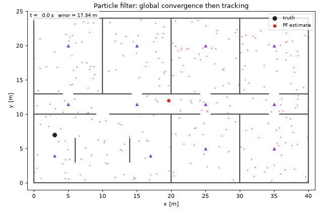
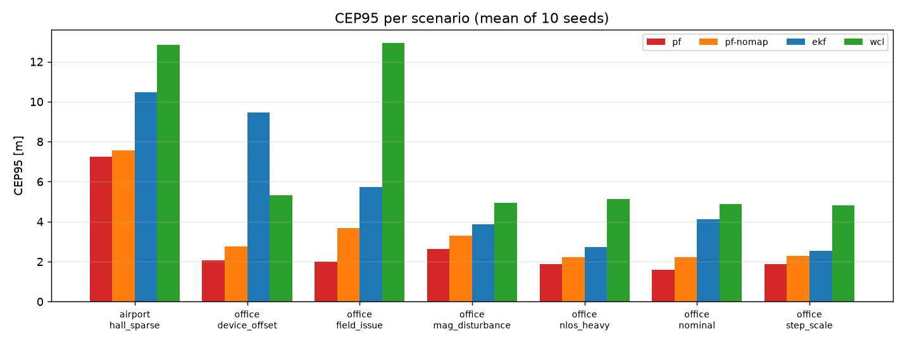
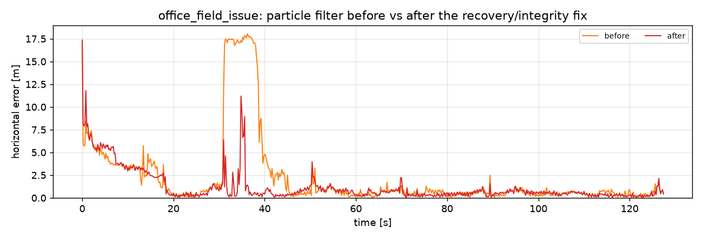
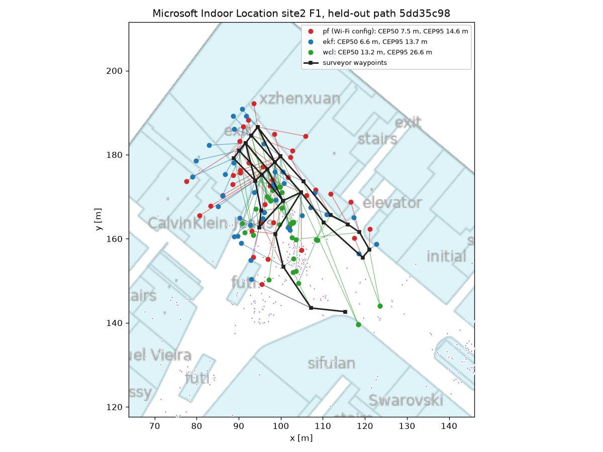
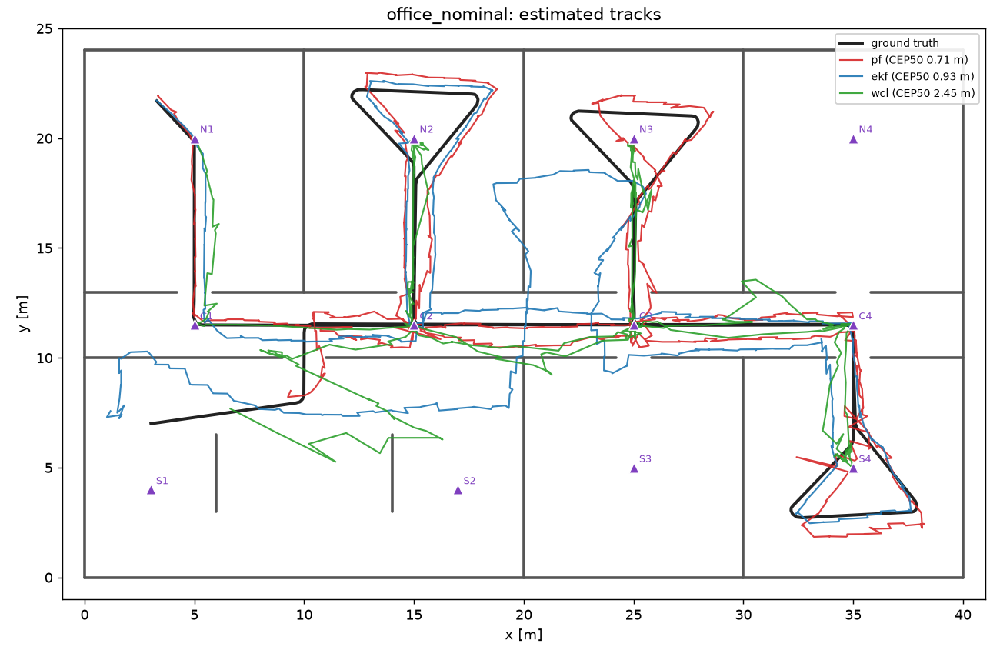
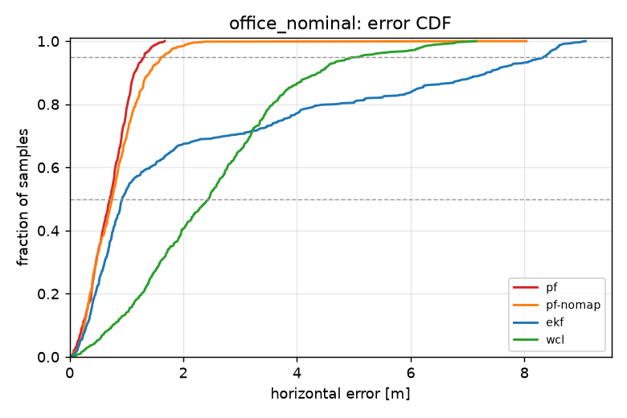
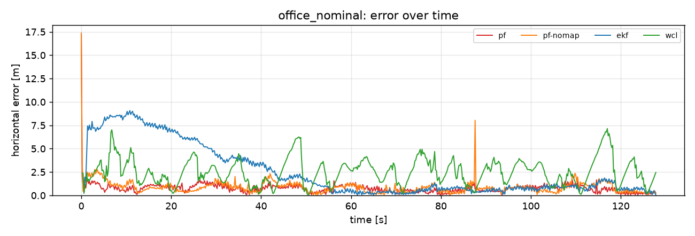
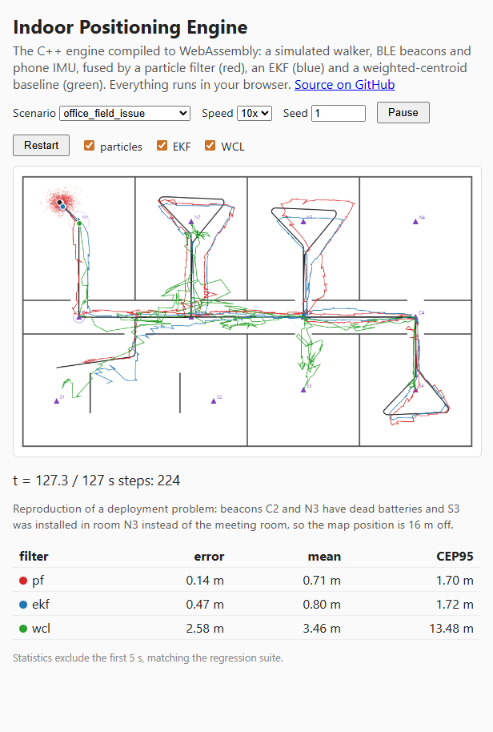
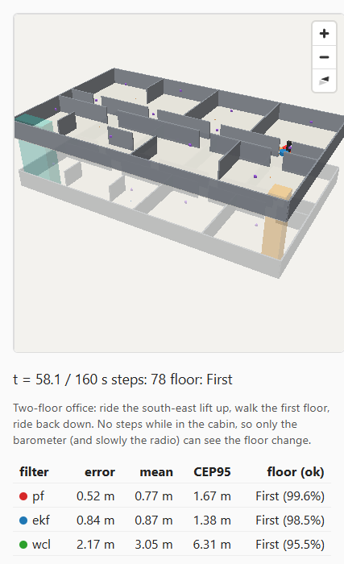

# Indoor Positioning Engine

[](https://github.com/Yusufss4/indoor-positioning-engine/actions/workflows/ci.yml)

A C++20 indoor positioning engine that turns noisy phone sensor data (IMU + BLE RSSI + barometer) into a
blue dot on the right floor, plus the tooling to measure it: a multi-floor venue simulator, trace replay, an
accuracy regression suite that gates CI, Python visualisation, GeoJSON/IMDF map import and export, and a
WebAssembly build that runs the same engine in the browser with a 2D and a 3D (MapLibre) view.

**[Live demo (WebAssembly)](https://yusufss4.github.io/indoor-positioning-engine/)**



## What is inside

| Component | Description |
|---|---|
| **Pedestrian dead reckoning** | Step detection on accelerometer magnitude, Weinberg step length, gyro yaw integration, magnetometer heading |
| **Particle filter** | Fuses steps, heading, RSSI and pressure; walls kill particles that cross them and attenuate radio in the likelihood; per-particle step-length scale, device RSSI offset, floor and barometer offset states; floor changes only inside stairwells and lifts; robust likelihoods; systematic resampling; augmented-MCL recovery; beacon integrity monitor; optional beacon-driven init/recovery proposal with exact importance weights |
| **EKF** | `[x, y, heading]` with Jacobian-based prediction, scalar RSSI/heading updates, chi-square gating and Joseph-form covariance update; floor from an anchored barometer |
| **Weighted centroid** | RSSI-only baseline with a beacon floor vote |
| **Floors** | Venues with levels, stairwells, lifts and escalators; 3D radio distance with slab loss; barometric altitude with low-pass filtering; floor accuracy and floor-switch latency metrics |
| **Simulator** | Pure-pursuit walker through a floor plan, up stairs and in lifts; synthesises 50 Hz IMU, BLE with fading, shadowing, wall and slab loss, path-loss mismatch, device offsets, packet loss, magnetic anomalies, dead and moved beacons, and a phone barometer with weather drift, device bias and door spikes |
| **Replay + metrics** | Mean, RMSE, CEP50, CEP95, availability, time to first fix, convergence time, floor accuracy, floor-switch latency, compute per update |
| **Regression suite** | 11 scenarios x 4 filter presets x N seeds compared against a stored baseline in CI |
| **Map interop** | `ipe-import`: GeoJSON (any platform, through a property mapping table) and an IMDF subset in and out, with WGS84 georeferencing |
| **WebAssembly** | Emscripten/embind build of the unchanged core with a 2D canvas and a 3D MapLibre view, deployed to GitHub Pages |
| **Agent tooling** | [`AGENTS.md`](AGENTS.md) with evaluation rules for coding agents; MCP server in [positioning-agent-tools](https://github.com/Yusufss4/positioning-agent-tools) |

## Results

Mean over 10 seeds per scenario; errors after a 5 s warm-up; compute time is single-threaded wall clock per
sensor update (IMU and BLE averaged) on a desktop CPU. Full table: [docs/results.md](docs/results.md).

| Scenario | What it stresses | PF CEP50 / CEP95 | PF without map | EKF | Weighted centroid |
|---|---|---|---|---|---|
| office_nominal | reference walk | **0.66 / 1.59** | 0.82 / 2.23 | 0.95 / 4.13 | 2.32 / 4.88 |
| office_nlos_heavy | walls lose 7 dB, map says 3.5 | **0.65 / 1.87** | 0.86 / 2.22 | 0.98 / 2.72 | 2.31 / 5.14 |
| office_device_offset | phone reads 9 dB low | **0.75 / 2.05** | 0.96 / 2.77 | 7.00 / 9.45 | 2.48 / 5.31 |
| office_mag_disturbance | magnetic anomalies, gyro bias | **1.09 / 2.63** | 1.45 / 3.29 | 1.60 / 3.85 | 2.28 / 4.93 |
| office_field_issue | 2 dead beacons, 1 installed 16 m off | **0.72 / 2.00** | 1.01 / 3.67 | 2.85 / 5.75 | 2.99 / 12.95 |
| office_step_scale | walker's step 17% shorter than modelled | **0.73 / 1.87** | 0.81 / 2.28 | 0.97 / 2.55 | 2.23 / 4.80 |
| airport_hall_sparse | 80 x 40 m hall, beacons 20 m apart, 35% loss | **1.30 / 7.25** | 1.41 / 7.58 | 1.61 / 10.47 | 4.73 / 12.85 |



### Two floors

`office_two_floor` stacks a second, more open floor 4 m above the office, joined by a stairwell and a lift.
"Floor ok" is the share of fixes on the right floor; CEP only counts those. "Switch" is the mean delay
between the walker reaching the new floor and the estimate following (10 seeds each).

| Scenario | What it stresses | PF CEP50 / CEP95 | PF floor ok / switch | EKF floor ok / switch | WCL floor ok / switch |
|---|---|---|---|---|---|
| office_stairs_up_down | stairs up, tour, stairs down | **0.78** / 3.22 | **99.5%** / 0.4 s | 98.7% / 1.0 s | 98.1% / 1.4 s |
| office_elevator | lift rides: no steps, only pressure changes | **0.60 / 1.76** | **99.5%** / 0.4 s | 98.9% / 0.9 s | 98.3% / 1.2 s |
| office_floor_bleed | slab loses 4 dB (map says 15): beacons below look close | **0.89** / 4.02 | **96.3%** / 1.0 s | 95.7% / 2.9 s | 95.2% / 2.1 s |
| baro_drift_long | weather trend -6 hPa/h, phone barometer 2.5 hPa off | **0.63 / 1.99** | **99.5%** / 0.4 s | 67.4% / 25.2 s | 98.4% / 1.4 s |

The barometer offset each particle carries is what keeps it right under weather drift. The EKF anchors the
barometer once and snaps to the nearest floor, so a 6 hPa/h trend (50 m of apparent altitude per hour) puts
it on the wrong floor a third of the time. The particle filter's CEP95 on the stair scenario (3.2 m) is
worse than the EKF's (2.3 m). The large errors cluster after floor changes: the 15 s after a change are a
fifth of the walk but hold half of the errors above the 95th percentile (5 seeds), while the cloud is still
spread around the stairwell exit and the new floor's beacons pin it down. Single-floor results are
bit-identical to the engine before floors were added.

The simulator and the filters share a model family, so absolute numbers are optimistic compared to
real venues. The comparisons between filters and the before/after deltas are the point. See
[docs/design.md](docs/design.md#known-model-limitations), and the real phone traces below for how large
the gap is.

### Field issue to engine fix

`office_field_issue` reproduces a deployment fault. One beacon is mounted in a different room than the
map says, and two have dead batteries. The map-aware particle filter was initially *worse* than the
map-free one there (CEP95 5.4 m vs 2.4 m), because recovery particles locked onto the beacon's mapped
position (17 m error for 10 s). Widening the per-user priors and slowing the recovery trigger fixed it
(20 seeds: CEP95 3.7 -> 2.0 m; device offset 3.8 -> 2.9 m). It is a trade-off, not a free win: slower
recovery costs the sparse airport hall (5.6 -> 7.3 m) and the short-stride walker (1.5 -> 1.8 m); the
other three scenarios are unchanged within noise. The investigation, including the variants that did
not work and the ablation of that cost, is in [docs/experiments.md](docs/experiments.md).



### Beacon-driven start for open halls

In the airport hall, the filter took ~70 s to converge from a uniform start over 3200 m^2. An opt-in
proposal seeds the cloud from a range ring around the closest-looking beacon, with importance weights
so the posterior is unchanged. It cuts convergence to 41 s and CEP95 from 7.3 to 5.4 m (20 seeds),
and helps the two-floor walks. In the small walled offices it slows convergence by a few seconds, so
it is not on by default. [`data/configs/open_venue.json`](data/configs/open_venue.json) enables it; the
numbers, the ablation and the variants that failed are experiment 4 in
[docs/experiments.md](docs/experiments.md).

### Real phone traces

The [Microsoft Indoor Location](https://github.com/location-competition/indoor-location-competition-20)
sample (two malls, 14 floors, Android IMU + Wi-Fi, surveyor waypoints) converts into engine venues and
traces with [`datasets/msil/`](datasets/msil/). The radio map is fitted on 80% of the walks, settings are
chosen on half of the rest, and results are reported on the other half (109 walks):

| Filter | Median CEP50 / CEP95 over walks [m] |
|---|---|
| PF, default | 11.7 / 20.5 |
| PF, [Wi-Fi config](data/configs/msil_wifi.json) (sigma 8 dB, 5k particles, beacon-driven proposal) | 7.0 / 11.1 |
| PF, Wi-Fi config, one update per Wi-Fi scan | 7.1 / **9.5** |
| EKF | 7.8 / 10.4 |
| Weighted centroid | 8.4 / 14.9 |

Real errors are about ten times the simulated office's. The particle filter only matches the EKF once
virtual access points (one radio, up to six BSSIDs) are merged and the start is seeded from the
closest-looking access point, and it pulls ahead on CEP95 once each Wi-Fi scan is applied as one update
instead of 40 separate ones. Its uncertainty is still far too small: a new calibration metric
(`coverage95`) shows the 95% ellipse holding the truth for under a fifth of the fixes. Method, per-floor
numbers and failure modes: [docs/real_data.md](docs/real_data.md).
Three of the held-out walks play in the [live demo](https://yusufss4.github.io/indoor-positioning-engine/)
under "Real recordings", over the mall's floor plan.



<details>
<summary>Tracks and error CDF on office_nominal</summary>





</details>

## Quick start

```bash
cmake -S . -B build -DCMAKE_BUILD_TYPE=Release
cmake --build build -j
ctest --test-dir build --output-on-failure          # 98 unit tests + accuracy regression
                                                     # (+ real-data regression once datasets/msil/out_scans exists)

# simulate a scenario and replay it through a filter
./build/tools/ipe-sim --scenario data/scenarios/office_nominal.json --out /tmp/trace.csv
./build/tools/ipe-replay --venue data/venues/office_floor.json --trace /tmp/trace.csv --filter pf --out /tmp/est.csv

# two floors: the trace also carries barometer samples; metrics add floor_accuracy and floor_switch_latency_s
./build/tools/ipe-sim --scenario data/scenarios/office_stairs_up_down.json --out /tmp/stairs.csv
./build/tools/ipe-replay --venue data/venues/office_two_floor.json --trace /tmp/stairs.csv --filter pf

# A/B experiment: does the beacon integrity monitor help, across every scenario and 10 seeds?
./build/tools/ipe-regress --scenarios data/scenarios --no-baseline --seeds 10 --presets pf \
    --set '{"pf":{"beacon_integrity":false}}'

# regenerate all figures in docs/
python3 -m venv .venv && .venv/bin/pip install -r viz/requirements.txt
.venv/bin/python viz/make_figures.py
```

WebAssembly build (requires emsdk):

```bash
emcmake cmake -S . -B build-wasm -DCMAKE_BUILD_TYPE=Release && cmake --build build-wasm -j
python3 -m http.server -d build-wasm/site 8000   # open http://localhost:8000
```



The 2D view draws one floor at a time: the walker's floor by default, or any floor picked in the Floor
menu. Trails show only that floor, estimates on another floor are drawn as dashed rings, and the stats
table adds a floor column for two-floor scenarios. The "Real recordings" scenarios replay phone walks from
two shopping malls instead of simulating one, over the mall's floor plan, with the surveyor's waypoints as
squares.

The **3D** button switches to a MapLibre GL view of the venue: walls extruded per floor, translucent slabs,
stair and lift shafts, the walker, each filter's estimate with its uncertainty, and the particles coloured
by floor. The estimated floor is drawn opaque, floors above it nearly vanish, and "Exploded" pulls the
floors apart. MapLibre loads from a CDN on first use with a blank style (no tile keys); an OpenStreetMap
underlay is optional.



## Maps from other platforms (GeoJSON, IMDF)

The engine's venue JSON is local metres. `ipe-import` converts it to and from what indoor-mapping
platforms publish, using the venue's `georef` (origin latitude/longitude and rotation):

```bash
./build/tools/ipe-import export data/venues/office_two_floor.json --out office.geojson    # WGS84 GeoJSON
./build/tools/ipe-import export-imdf data/venues/office_two_floor.json --out imdf/       # IMDF subset
./build/tools/ipe-import imdf imdf/ --out venue.json                                      # and back
./build/tools/ipe-import geojson their_export.geojson --mapping my_mapping.json \
    --beacon-grid 8 --out venue.json
```

- **IMDF** (Apple's Indoor Mapping Data Format, also used by many mapping vendors): levels, units and
  openings become floors, walls (room outlines with doors cut out) and stair/lift connectors.
- **Any GeoJSON** goes through a mapping table that names the property and values meaning wall, room,
  door, level, stairs, lift or beacon. Supporting a new platform's export is a JSON file, not code;
  [`data/mappings/ipe.json`](data/mappings/ipe.json) is the table for this project's own export.
- Map data has no beacons, so they come from a sidecar file (`--beacons`, with lat/lon) or a grid.

Formats in detail: [docs/formats.md](docs/formats.md#geojson-and-imdf-ipe-import).

## Engineering notes

- **Deterministic everywhere.** All sampling goes through a xoshiro256** generator with Box-Muller
  normals, because `std::normal_distribution` differs between standard libraries. The WebAssembly build
  (Clang/libc++) reproduces native GCC/libstdc++ metrics exactly for the same seed.
- **Spatial index.** Wall queries (motion constraint and radio wall-count) use a uniform grid. A property
  test checks it against brute force on 5000 random segments.
- **CI** builds with GCC and Clang with `-Werror`, runs unit tests under ASan and UBSan, enforces
  clang-format, runs the accuracy regression, builds the WASM module and deploys the demo.
- **Config as data.** Every tuning parameter is reachable through JSON merge patches (`--set`, `--config`).
  Unknown keys are rejected so experiment typos fail loudly.

## Repository layout

```
core/     engine: PDR, RSSI model, barometer, particle filter, EKF, WCL, venue + georef + trace I/O
sim/      scenario -> synthetic trace
eval/     presets, config overrides, replay, metrics, benchmark/baseline comparison
geo/      GeoJSON / IMDF import and export
tools/    ipe-sim, ipe-replay, ipe-regress, ipe-import
tests/    GoogleTest unit tests, regression baseline
data/     venues, scenarios, engine config patches, GeoJSON exports, IMDF sample, mapping tables,
          three real recordings for the web demo
datasets/ fetch + convert scripts for public real-data recordings (the raw data is not committed)
viz/      matplotlib figures and animation
web/      embind bindings, 2D canvas and 3D MapLibre front end
docs/     design notes, file formats, experiment log, results, real-data evaluation
```

## License

MIT
