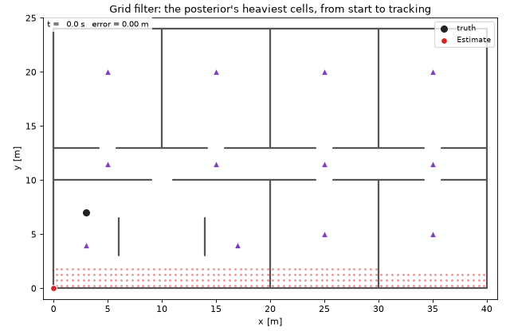
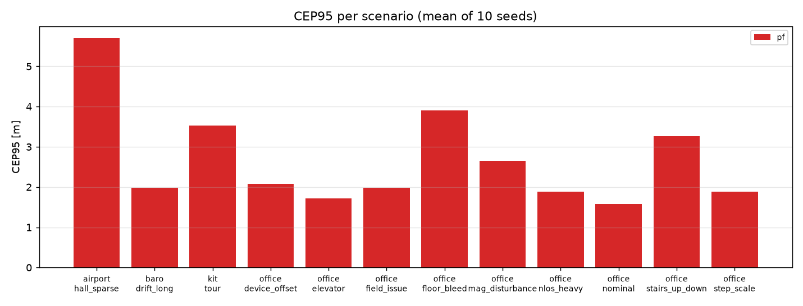
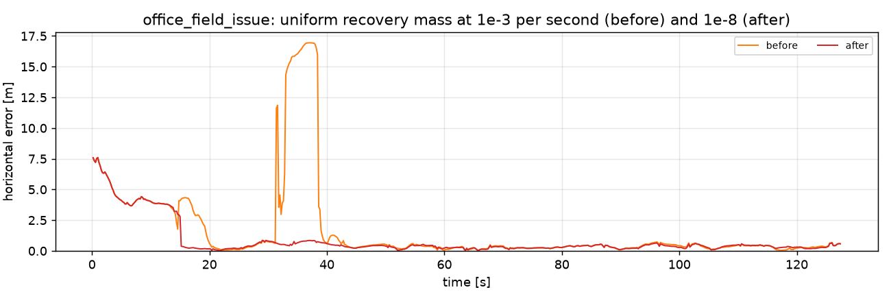
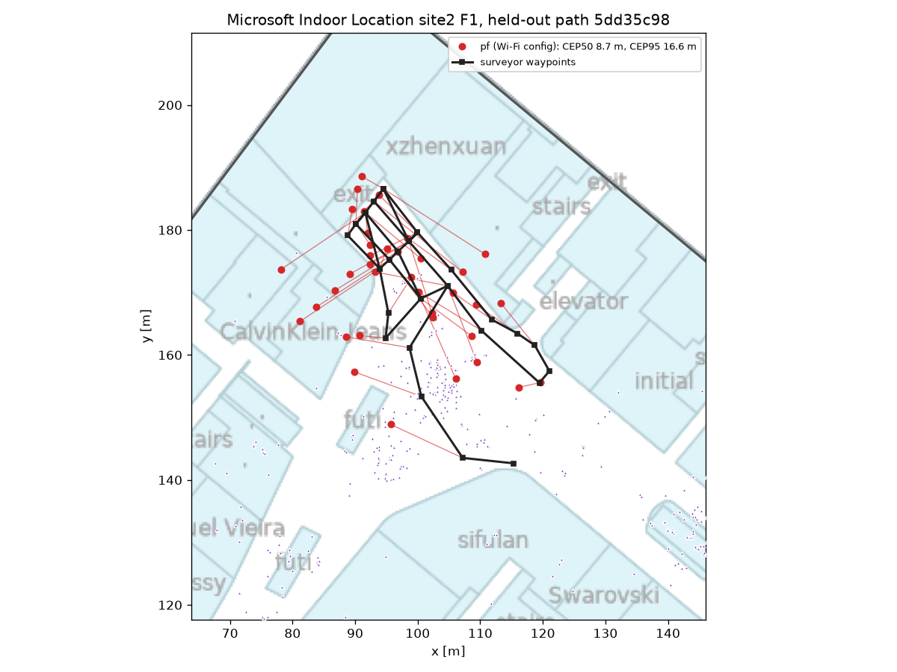
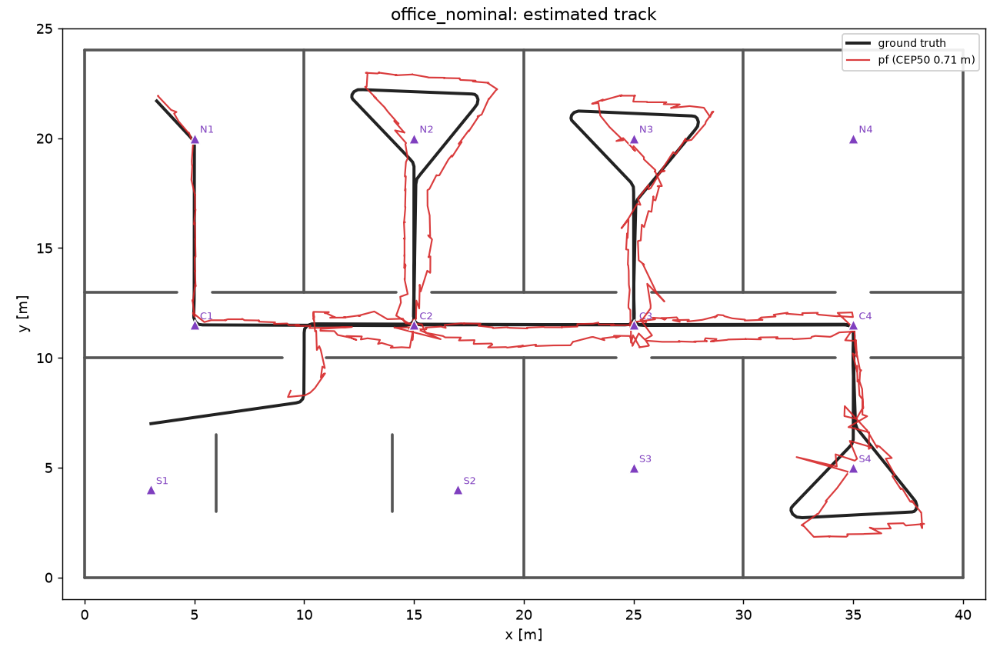
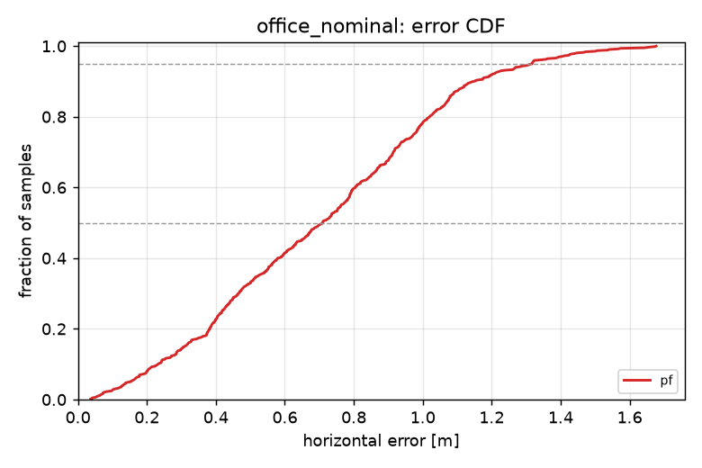
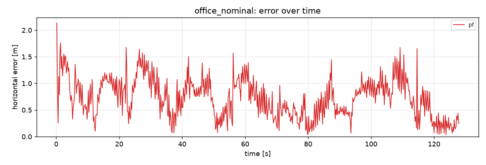
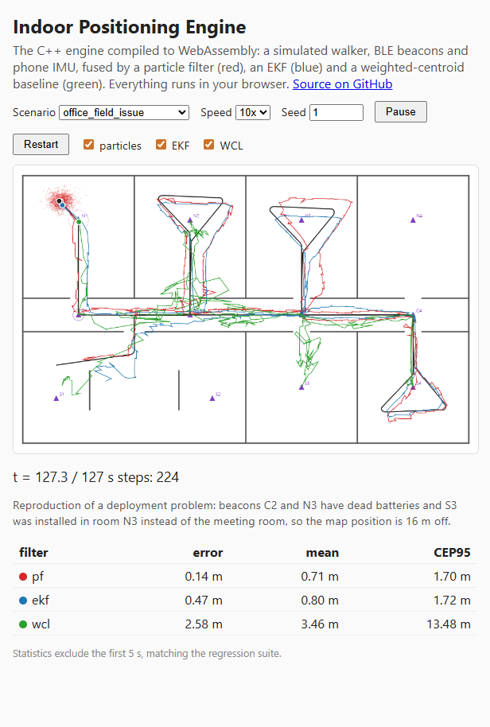
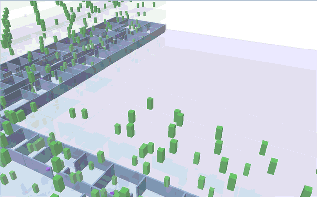

# Indoor Positioning Engine

[](https://github.com/Yusufss4/indoor-positioning-engine/actions/workflows/ci.yml)

A C++20 indoor positioning engine that turns noisy phone sensor data (IMU + BLE RSSI + barometer) into a
blue dot on the right floor, plus the tooling to measure it: a multi-floor venue simulator, trace replay, an
accuracy regression suite that gates CI, Python visualisation, GeoJSON/IMDF map import and export, and a
WebAssembly build that runs the same engine in the browser with a 2D and a 3D (MapLibre) view.

**[Live demo (WebAssembly)](https://yusufss4.github.io/indoor-positioning-engine/)**



## What is inside

| Component | Description |
|---|---|
| **Pedestrian dead reckoning** | Step detection on accelerometer magnitude, Weinberg step length, gyro yaw integration, magnetometer heading |
| **Grid filter** | The whole posterior as probability mass on a 0.5 m lattice of the venue's walkable cells, with a heading distribution per cell; fuses steps, heading, RSSI and pressure; a move that crosses a wall is not possible and walls attenuate radio in the likelihood; device RSSI offset and barometer offset as a Gaussian per cell; floor changes only inside stairwells and lifts; robust likelihoods; beacon integrity monitor; optional Wi-Fi fingerprint likelihood and floor vote; the reported position stays on the map; no random numbers, so the same input gives the same output |
| **Floors** | Venues with levels, stairwells, lifts and escalators; 3D radio distance with slab loss; barometric altitude with low-pass filtering; floor accuracy and floor-switch latency metrics |
| **Room events** | Named rooms on every shipped map (hand-drawn, from OpenStreetMap, from the mall unit polygons); debounced Enter/Exit events from the probability mass in each room, with hysteresis and dwell; scored against ground truth (precision, recall, latency, room accuracy); event log and room highlight in the web demo |
| **Simulator** | Pure-pursuit walker through a floor plan, up stairs and in lifts; synthesises 50 Hz IMU, BLE with fading, shadowing, wall and slab loss, path-loss mismatch, device offsets, packet loss, magnetic anomalies, dead and moved beacons, and a phone barometer with weather drift, device bias and door spikes |
| **Replay + metrics** | Mean, RMSE, CEP50, CEP95, availability, time to first fix, convergence time, floor accuracy, floor-switch latency, room-event precision/recall/latency, smoothness of the drawn track (jitter, jumps per minute, floor flips, path ratio), compute per update |
| **Regression suite** | 12 scenarios x N seeds compared against a stored baseline in CI, plus 109 real mall walks and 6 IPIN competition walks when the datasets are present |
| **Map interop** | `ipe-import`: GeoJSON (any platform, through a property mapping table) and an IMDF subset in and out, with WGS84 georeferencing |
| **WebAssembly** | Emscripten/embind build of the unchanged core with a 2D canvas and a 3D MapLibre view, deployed to GitHub Pages |
| **Agent tooling** | [`AGENTS.md`](AGENTS.md) with evaluation rules for coding agents; MCP server in [positioning-agent-tools](https://github.com/Yusufss4/positioning-agent-tools) |

## Results

Mean over 10 seeds per scenario; errors after a 5 s warm-up; compute time is single-threaded wall clock per
sensor update (IMU and BLE averaged) on a desktop CPU. Full table: [docs/results.md](docs/results.md).

| Scenario | What it stresses | CEP50 / CEP95 [m] |
|---|---|---|
| office_nominal | reference walk | 0.55 / 1.14 |
| office_nlos_heavy | walls lose 7 dB, map says 3.5 | 0.57 / 1.28 |
| office_device_offset | phone reads 9 dB low | 0.49 / 1.15 |
| office_mag_disturbance | magnetic anomalies, gyro bias | 0.94 / 2.65 |
| office_field_issue | 2 dead beacons, 1 installed 16 m off | 0.56 / 1.68 |
| office_step_scale | walker's step 17% shorter than modelled | 0.78 / 1.77 |
| airport_hall_sparse | 80 x 40 m hall, beacons 20 m apart, 35% loss | 1.01 / 3.76 |



### Two floors

`office_two_floor` stacks a second, more open floor 4 m above the office, joined by a stairwell and a lift.
"Floor ok" is the share of fixes on the right floor; CEP only counts those. "Switch" is the mean delay
between the walker reaching the new floor and the estimate following (10 seeds each).

| Scenario | What it stresses | CEP50 / CEP95 [m] | Floor ok / switch |
|---|---|---|---|
| office_stairs_up_down | stairs up, tour, stairs down | 0.58 / 1.63 | 99.1% / 0.7 s |
| office_elevator | lift rides: no steps, only pressure changes | 0.54 / 1.28 | 99.0% / 0.8 s |
| office_floor_bleed | slab loses 4 dB (map says 15): beacons below look close | 0.68 / 1.50 | 97.9% / 1.6 s |
| baro_drift_long | weather trend -6 hPa/h, phone barometer 2.5 hPa off | 0.54 / 1.42 | 99.2% / 0.8 s |

The barometer offset each cell carries is what keeps it right under weather drift: a 6 hPa/h trend is
50 m of apparent altitude per hour, and the filter still reports the right floor 99.2% of the time.

The simulator and the filter share a model family, so absolute numbers are optimistic compared to
real venues. The before/after deltas are the point. See
[docs/design.md](docs/design.md#known-model-limitations), and the real phone traces below for how large
the gap is.

### A moved beacon

`office_field_issue` reproduces a deployment fault. One beacon is mounted in a different room than the
map says, and two have dead batteries. The moved beacon reads 25 dB hot where the walker is, and any
probability mass sitting at its mapped position wins within a few packets, before the integrity monitor can
exclude it. How much mass is there is the recovery rate: with 0.1% of uniform mass mixed in per second,
CEP95 on this walk is 3.65 m (about 17 m off for 7 s on the default seed, below); with the default 1e-8 it
is 1.7 m (10 seeds). The investigation, and the earlier one on the particle filter this engine used to have, is in
[docs/experiments.md](docs/experiments.md) (experiments 2 and 14).



### Real phone traces

The [Microsoft Indoor Location](https://github.com/location-competition/indoor-location-competition-20)
sample (two malls, 14 floors, Android IMU + Wi-Fi, surveyor waypoints) converts into engine venues and
traces with [`datasets/msil/`](datasets/msil/). The radio map is fitted on 80% of the walks, settings are
chosen on half of the rest, and results are reported on the other half (109 walks):

| Config | Median CEP50 / CEP95 over walks [m] |
|---|---|
| [Wi-Fi config](data/configs/msil_wifi.json) (RSSI sigma 8 dB), log-distance radio model | 6.8 / 9.4 |
| [Fingerprint config](data/configs/fingerprint.json): the training scans as position fingerprints | **5.2** / **8.9** |

Real errors are about ten times the simulated office's. Merging virtual access points (one radio, up to six
BSSIDs) and applying each Wi-Fi scan as one update instead of 40 separate ones are what brought them down
on the data side. The uncertainty is still far too small: the 95% ellipse holds the truth for under a fifth
of the fixes (`coverage95`). Method, per-floor numbers and failure modes:
[docs/real_data.md](docs/real_data.md).
Two more public datasets test what MSIL cannot:
- **IPIN Track 3** ([docs/ipin.md](docs/ipin.md), [`datasets/ipin/`](datasets/ipin/)): two buildings with
  barometer data and stairs, with walls extracted from the competition's floor plans. The floor is the
  hard part with a radio model alone: it barely separates floors, although a Wi-Fi fingerprint finds the
  floor for 93–95% of scans.
- **Against the competitions' leaderboards** ([docs/benchmarks.md](docs/benchmarks.md)): with the training
  scans used as position fingerprints (opt-in, `data/configs/fingerprint.json`), the IPIN competition's
  metric on its scoring walks is 5.0–8.6 m per walk with the floor right for 94–97% of the landmarks, which
  is the range of the 2023 and 2024 winners (5.3 and 7.9 m). On Kaggle's indoor location competition the
  engine stays well behind the winner's 1.50 m (5.30 m, with offline steps); that page says why.
- **UJI BLE** ([docs/uji_ble.md](docs/uji_ble.md), [`datasets/uji_ble/`](datasets/uji_ble/)): surveyed
  beacons and standing-still fingerprints. They confirm the 5 dB RSSI spread, measure about 1 dB per
  shelf edge rather than 3 dB per wall, and give 1.4–1.9 m CEP50 from BLE alone.

Ten held-out walks, one on each floor whose longest held-out walk lasts at least a minute, play in the
[live demo](https://yusufss4.github.io/indoor-positioning-engine/) under "Real recordings", over the
mall's floor plan, with the floor's training scans as position fingerprints (`fingerprint.json`).



### A real building from OpenStreetMap

[`datasets/osm/`](datasets/osm/) turns a building mapped with OpenStreetMap's indoor tagging into a venue:
the KIT Informatikbau in Karlsruhe, 7 levels, 1,273 walls from room outlines with 282 doorways cut out,
5 stairwells and 3 lifts. The walk in `kit_tour` is planned through the mapped doors and stairs (A* on the
plan, checked by `ipe-sim` for wall crossings), and the phone is simulated. Mean over 10 seeds:

| | CEP50 / CEP95 [m] | Converged |
|---|---|---|
| Default config | **0.65** / **2.67** | 10/10, in under a second |

The L-shaped building covers 38% of its bounding box. The building outline is the venue's
[`footprint`](docs/formats.md#venue-datavenuesjson), and the filter's cells exist only inside it, so no
probability can sit outside the building. The synthetic venues fill their bounds and have no footprint.

<details>
<summary>Tracks and error CDF on office_nominal</summary>





</details>

## Quick start

```bash
cmake -S . -B build -DCMAKE_BUILD_TYPE=Release
cmake --build build -j
ctest --test-dir build --output-on-failure          # 177 unit tests + accuracy regression
                                                     # (+ real-data regressions once the datasets are converted)

# simulate a scenario and replay it through the engine
./build/tools/ipe-sim --scenario data/scenarios/office_nominal.json --out /tmp/trace.csv
./build/tools/ipe-replay --venue data/venues/office_floor.json --trace /tmp/trace.csv --out /tmp/est.csv

# two floors: the trace also carries barometer samples; metrics add floor_accuracy and floor_switch_latency_s
./build/tools/ipe-sim --scenario data/scenarios/office_stairs_up_down.json --out /tmp/stairs.csv
./build/tools/ipe-replay --venue data/venues/office_two_floor.json --trace /tmp/stairs.csv

# room Enter/Exit events (estimated and true) as CSV; metrics add room_event_precision/recall
./build/tools/ipe-replay --venue data/venues/office_floor.json --trace /tmp/trace.csv --events /tmp/events.csv

# A/B experiment: does the beacon integrity monitor help, across every scenario and 10 seeds?
./build/tools/ipe-regress --scenarios data/scenarios --no-baseline --seeds 10 \
    --set '{"filter":{"beacon_integrity":false}}'

# regenerate all figures in docs/
python3 -m venv .venv && .venv/bin/pip install -r viz/requirements.txt
.venv/bin/python viz/make_figures.py
```

WebAssembly build (requires emsdk):

```bash
emcmake cmake -S . -B build-wasm -DCMAKE_BUILD_TYPE=Release && cmake --build build-wasm -j
python3 -m http.server -d build-wasm/site 8000   # open http://localhost:8000
```

Every build copies `data/` into the site again. With the full Kaggle set converted
([docs/benchmarks.md](docs/benchmarks.md#reproduce)), `datasets/kaggle/export_demo.py` adds one held-out
walk per floor of its 24 test buildings to the local demo's menu (`data/real_kaggle/`, git-ignored: the
competition's data may not be redistributed, so the deployed demo does not have them).



The 2D view draws one floor at a time: the walker's floor by default, or any floor picked in the Floor
menu. Trails show only that floor, estimates on another floor are drawn as dashed rings, and the stats
table adds a floor column for two-floor scenarios. The "Real recordings" scenarios replay phone walks from
two shopping malls instead of simulating one, over the mall's floor plan, with its shop walls and the
surveyor's waypoints as squares. `kit_tour` simulates a walk through a real seven-floor university
building imported from OpenStreetMap; the demo opens on it, in the 3D view. The estimate is a green dot,
and the most probable cells of the [grid filter](docs/grid.md) are green squares, darker with more
probability. Rooms are drawn on the plan with the filter's
current rooms tinted green and the true room outlined; the Rooms panel lists the filter's current rooms
and a log of Enter/Exit events, the walker's true events included. The 3D view highlights the filter's
current rooms.

The **3D** button switches to a MapLibre GL view of the venue: walls extruded per floor, translucent slabs,
stair and lift shafts, the walker, the estimate with its uncertainty, and the grid filter's cells as
bars, taller with more probability. The estimated floor is drawn opaque, floors above it nearly vanish, and "Exploded" pulls the
floors apart. MapLibre loads from a CDN on first use with a blank style (no tile keys); an OpenStreetMap
underlay is optional.



`kit_tour` in 3D, recorded when the demo still ran the particle filter: the walker (black) climbs the west
stairwell from L1 to L2, then rides the north lift down to L0. The floor the walker is on turns opaque, and
the particles follow it up and down.

A timeline under the map works in both views: drag it to any moment, play forwards or in reverse, or step
frame by frame (Space, the arrow keys and J/K/L do the same). The page keeps every frame the engine has
computed, so going back replays them, and dragging past the computed part runs the engine to catch up.

## Maps from other platforms (GeoJSON, IMDF)

The engine's venue JSON is local metres. `ipe-import` converts it to and from what indoor-mapping
platforms publish, using the venue's `georef` (origin latitude/longitude and rotation):

```bash
./build/tools/ipe-import export data/venues/office_two_floor.json --out office.geojson    # WGS84 GeoJSON
./build/tools/ipe-import export-imdf data/venues/office_two_floor.json --out imdf/       # IMDF subset
./build/tools/ipe-import imdf imdf/ --out venue.json                                      # and back
./build/tools/ipe-import geojson their_export.geojson --mapping my_mapping.json \
    --beacon-grid 8 --out venue.json
```

- **IMDF** (Apple's Indoor Mapping Data Format, also used by many mapping vendors): levels, units and
  openings become floors, walls (room outlines with doors cut out) and stair/lift connectors.
- **Any GeoJSON** goes through a mapping table that names the property and values meaning wall, room,
  door, level, stairs, lift or beacon. Supporting a new platform's export is a JSON file, not code;
  [`data/mappings/ipe.json`](data/mappings/ipe.json) is the table for this project's own export.
- **OpenStreetMap** indoor data (Simple Indoor Tagging) needs geometry work a table cannot do (doors are
  points on room outlines; stairwells list several levels), so
  [`datasets/osm/convert.py`](datasets/osm/convert.py) writes it out in the `ipe` scheme first.
- Map data has no beacons, so they come from a sidecar file (`--beacons`, with lat/lon) or a grid.

Formats in detail: [docs/formats.md](docs/formats.md#geojson-and-imdf-ipe-import).

## Engineering notes

- **Deterministic.** The filter draws no random numbers: a trace gives the same estimate every time. The
  simulator's sampling goes through a xoshiro256** generator with Box-Muller normals, because
  `std::normal_distribution` differs between standard libraries, so a scenario's trace is the same under
  GCC/libstdc++ and Clang/libc++ (WebAssembly).
- **Spatial index.** Wall queries (motion constraint and radio wall-count) use a uniform grid. A property
  test checks it against brute force on 5000 random segments.
- **CI** builds with GCC and Clang with `-Werror`, runs unit tests under ASan and UBSan, enforces
  clang-format, runs the accuracy regression, builds the WASM module and deploys the demo.
- **Config as data.** Every tuning parameter is reachable through JSON merge patches (`--set`, `--config`).
  Unknown keys are rejected so experiment typos fail loudly.

## Repository layout

```
core/     engine: PDR, RSSI model, barometer, grid filter, room events, venue + georef + trace I/O
sim/      scenario -> synthetic trace
eval/     config overrides, replay, metrics, benchmark/baseline comparison
geo/      GeoJSON / IMDF import and export
tools/    ipe-sim, ipe-replay, ipe-regress, ipe-import
tests/    GoogleTest unit tests, regression baseline
data/     venues, scenarios, engine config patches, GeoJSON exports, IMDF sample, mapping tables,
          ten real recordings for the web demo, an OpenStreetMap building snapshot (ODbL)
datasets/ fetch + convert scripts for public real-data recordings (the raw data is not committed)
          and for OpenStreetMap indoor maps
viz/      matplotlib figures and animation
web/      embind bindings, 2D canvas and 3D MapLibre front end
docs/     design notes, file formats, experiment log, results, real-data evaluation
```

## License

MIT
