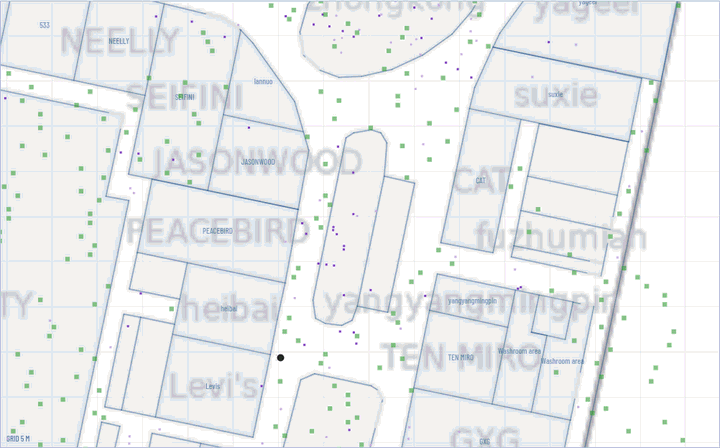

# Indoor Positioning Engine

[](https://github.com/Yusufss4/indoor-positioning-engine/actions/workflows/ci.yml)

A C++20 engine that turns a phone's sensor data (IMU, BLE and Wi-Fi signal strength, barometer) into a
position on the right floor of a building, with the tools to measure how well it does.

**[Live demo](https://yusufss4.github.io/indoor-positioning-engine/)**: the same engine, compiled to
WebAssembly, running in your browser.



A real walk through a shopping mall, replayed as the live demo draws it. Black squares are the points a
surveyor tapped (the only ground truth), the green dot and line are the engine's estimate, the green
shading is where it holds probability, and the purple dots are Wi-Fi access points. This walk ends with a
median error of 3.0 m; the ten mall walks in the demo have a median of 5.3 m.

## How it works

- **Steps** come from the accelerometer and gyroscope (pedestrian dead reckoning).
- **A grid filter** holds a probability for every 0.5 m cell of the floor plan. Steps move it, walls stop
  it, and radio and pressure readings reweight it. It draws no random numbers: the same input gives the
  same output on every platform.
- **Radio** is a log-distance model per beacon or access point and, where a venue has training scans,
  Wi-Fi fingerprints.
- **Floors** change only in stairwells and lifts, driven by the barometer and a Wi-Fi floor vote.
- **Output** is a smoothed position that stays on the map, its uncertainty, the floor, and enter/exit
  events for named rooms.

[docs/design.md](docs/design.md) has the detail.

## Datasets and results

| Dataset | What it is | Result |
|---|---|---|
| Simulated scenarios | 12 walks with injected faults (moved beacons, magnetic anomalies, weather drift, stairs and lifts), 10 seeds each | mean CEP50 0.66 m, CEP95 1.83 m; right floor 98–99% |
| [Microsoft Indoor Location](https://github.com/location-competition/indoor-location-competition-20) sample | 2 shopping malls, 14 floors, phone IMU + Wi-Fi; 109 held-out walks | median CEP50 5.2 m, CEP95 8.9 m |
| [IPIN competition](https://evaal.isti.cnr.it/) Track 3 | 2 buildings with stairs and barometer data; the competition's 6 scoring walks and its metric | 5.0–8.6 m per walk, right floor 94–97%. Winners: 5.3 m (2023), 7.9 m (2024), 30.1 m (2022) |
| [Kaggle Indoor Location & Navigation](https://www.kaggle.com/competitions/indoor-location-navigation) | 626 test walks in 24 buildings, scored by Kaggle | 5.30 m, with offline post-processing. Winner: 1.50 m |

- CEP50 and CEP95 are the median and the 95th percentile of the horizontal error.
- Settings are chosen on separate tuning walks; the numbers above are from held-out walks replayed once.
- Simulation is optimistic: real errors are about ten times the simulated office's.
- The engine reaches the IPIN winners' range and stays far behind the Kaggle winners, who learn the
  phone's motion with neural networks and optimise each walk as a whole.

Method, per-dataset tables and how to reproduce them: [docs/datasets.md](docs/datasets.md).

## Use it

**Build and test** (CMake 3.20+, a C++20 compiler):

```bash
cmake -S . -B build -DCMAKE_BUILD_TYPE=Release && cmake --build build -j
ctest --test-dir build -LE regression --output-on-failure    # unit tests, a few seconds
ctest --test-dir build -L regression --output-on-failure     # accuracy gate, under a minute; the
                                                             # real-data gates run once the datasets are converted
```

**Command line.** Simulate a walk, or replay a recorded one, and get the accuracy as JSON:

```bash
./build/tools/ipe-replay --scenario data/scenarios/office_nominal.json              # simulate and replay
./build/tools/ipe-replay --venue data/demo/msil/site1_F2/venue.json \
    --trace data/demo/msil/site1_F2/5dda5afcc5b77e0006b17719.csv \
    --config data/configs/fingerprint.json --out /tmp/estimates.csv                 # a recorded mall walk
./build/tools/ipe-regress --scenarios data/scenarios --no-baseline --seeds 10 \
    --set '{"filter": {"beacon_integrity": false}}'                                 # an A/B test of a setting
```

**As a library.** Link `ipe::core`; [`examples/minimal.cpp`](examples/minimal.cpp) is a complete program.

```cpp
const ipe::Venue venue = ipe::load_venue_file("venue.json");   // walls, floors, beacons, training scans
ipe::EngineConfig config;                                       // defaults; change with a JSON patch
ipe::PositioningEngine engine(venue, config);

engine.on_imu(sample);                // accelerometer, gyroscope, magnetometer
engine.on_scan(t, readings);          // a Wi-Fi scan (or on_ble for one BLE packet)
engine.on_pressure(t, hpa);           // barometer
const ipe::Estimate fix = engine.estimate();   // x, y, floor, covariance
```

**Your own building.** A venue is a JSON file of walls, floors and beacons in local metres
([docs/formats.md](docs/formats.md)). `ipe-import` converts GeoJSON exports of indoor-mapping platforms,
and `datasets/osm/convert.py` converts OpenStreetMap indoor data.

**Settings** are JSON patches over the defaults: `--config data/configs/fingerprint.json`, `--set '{...}'`,
or `ipe::apply_config_patch`. `ipe-replay --print-config` lists every setting. Unknown keys are rejected.

**Web demo** (needs the [Emscripten SDK](https://emscripten.org/docs/getting_started/downloads.html)):

```bash
emcmake cmake -S . -B build-wasm -DCMAKE_BUILD_TYPE=Release && cmake --build build-wasm -j
python3 -m http.server -d build-wasm/site 8000      # open http://localhost:8000
```

## Repository layout

```
core/      the engine: steps, grid filter, radio and barometer models, room events, venue and trace files
sim/       scenario -> simulated sensor trace with ground truth
eval/      replay, metrics, comparison against the accuracy baselines
geo/       GeoJSON import and export
tools/     ipe-sim, ipe-replay, ipe-regress, ipe-import
examples/  the engine as a library
web/       WebAssembly bindings and the browser demo (2D canvas, 3D MapLibre view)
datasets/  download and conversion scripts for the real datasets, and their evaluation
data/      venues, scenarios, config patches, demo recordings
tests/     unit tests and the accuracy baselines
viz/       figures and the demo GIF
docs/      design, file formats, datasets and results, how to extend, history
```

To add a sensor, a setting, a motion model or a dataset, start at
[docs/extending.md](docs/extending.md). [AGENTS.md](AGENTS.md) has the rules for evaluating a change.

## License

MIT. The demo recordings in `data/demo/` keep their sources' licences (MIT and CC BY 4.0), and the
OpenStreetMap building is ODbL.
