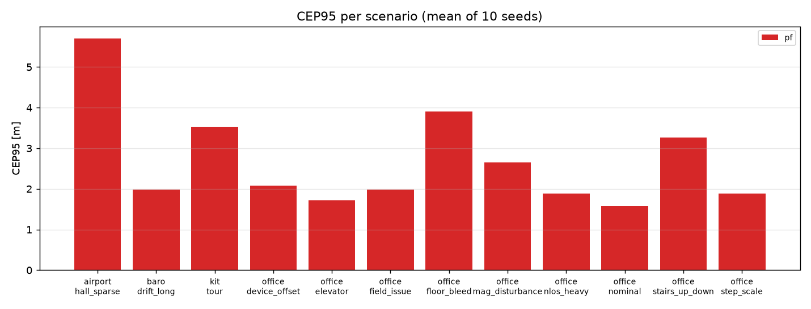

# Datasets and results

What the engine is measured on, how each dataset becomes venues and traces, and what it scores.

| Dataset | What it is | Result | Gate in CTest |
|---|---|---|---|
| [Simulated scenarios](#simulated-scenarios) | 12 walks through three hand-drawn venues and one OpenStreetMap building, 10 seeds each | mean CEP50 0.66 m, CEP95 1.83 m | `accuracy_regression` |
| [Microsoft Indoor Location sample](#microsoft-indoor-location-sample) | 2 malls, 14 floors, phone IMU + Wi-Fi, 109 held-out walks | median CEP50 5.2 m, CEP95 8.9 m | `real_data_regression` |
| [IPIN Track 3](#ipin-track-3) | 2 buildings, 3 floors each, stairs, barometer, 6 competition scoring walks | 5.0–8.6 m competition metric (winners: 5.3, 7.9, 30.1 m) | `ipin_regression` |
| [Kaggle Indoor Location & Navigation](#kaggle-indoor-location--navigation) | 24 test buildings of 204, 626 test walks scored by Kaggle | 5.30 m private score (winner: 1.50 m) | none: the data may not be redistributed |

The real datasets are downloaded by `datasets/*/fetch.sh` and are not in the repository. The two real-data
gates are skipped until the data is converted.

## How results are measured

- **CEP50 / CEP95**: the median and the 95th percentile of the horizontal error at the ground-truth
  samples, after a 5 s warm-up. Only fixes on the right floor count; `floor_accuracy` is their share.
- **Simulated walks** are scored at every truth sample, as means over seeds (`ipe-regress --seeds N`). The
  filter is deterministic, so the seeds are the simulator's: different walks of one scenario.
- **Recorded walks** are one replay each. Ground truth is only the points a surveyor tapped, so a walk has
  3–40 scored points; medians over walks are the headline numbers.
- **Tune and held-out.** Every dataset's converter writes `manifest_tune.json` and `manifest_holdout.json`.
  Settings are chosen on the tune walks only; the held-out walks are replayed once to report.
- **Smoothness** is reported with accuracy: `jitter_p95_m`, `jumps_per_min`, `level_flips` and
  `wall_crossings_per_min` ([formats.md](formats.md#replay-outputs)).
- **Competition metrics** (`datasets/evaluate.py`): IPIN's 75th percentile of the error plus 15 m per
  wrong floor at the landmarks, and Kaggle's mean of the error plus 15 m per floor of floor error.

## Simulated scenarios

`data/scenarios/*.json`: a walker follows waypoints through a venue while the simulator synthesises IMU,
BLE and barometer data with the fault each scenario names. Mean over 10 seeds
(`ipe-regress --scenarios data/scenarios --no-baseline --seeds 10`); the full table with smoothness and
compute is [results.md](results.md).

| Scenario | What it stresses | CEP50 / CEP95 [m] | Floor right |
|---|---|---|---|
| office_nominal | reference walk | 0.55 / 1.14 | |
| office_nlos_heavy | walls lose 7 dB, the map says 3.5 | 0.57 / 1.28 | |
| office_device_offset | phone reads 9 dB low | 0.49 / 1.15 | |
| office_mag_disturbance | magnetic anomalies, gyro bias | 0.94 / 2.65 | |
| office_field_issue | 2 dead beacons, 1 installed 16 m off | 0.56 / 1.68 | |
| office_step_scale | walker's step 17% shorter than modelled | 0.78 / 1.77 | |
| airport_hall_sparse | 80 x 40 m hall, beacons 20 m apart, 35% packet loss | 1.01 / 3.76 | |
| office_stairs_up_down | stairs up, tour, stairs down | 0.58 / 1.63 | 99.1% |
| office_elevator | lift rides: no steps, only pressure changes | 0.54 / 1.28 | 99.0% |
| office_floor_bleed | slab loses 4 dB (the map says 15): beacons below look close | 0.68 / 1.50 | 97.9% |
| baro_drift_long | weather trend -6 hPa/h, phone barometer 2.5 hPa off | 0.54 / 1.42 | 99.2% |
| kit_tour | 7-floor university building from OpenStreetMap, 5 stairwells, 3 lifts | 0.65 / 2.67 | 99.0% |



- The simulator and the filter share a family of models, so these numbers are optimistic. They are for
  before/after comparisons; the real data below says how large the gap is.
- `kit_tour` runs on the KIT Informatikbau in Karlsruhe, converted from OpenStreetMap's indoor tagging by
  `datasets/osm/convert.py` (1,273 walls, 282 doorways). The walk is planned through the mapped doors and
  stairs (`datasets/osm/plan_walk.py`); the phone is simulated. The building is L-shaped, and the venue's
  `footprint` keeps probability out of the 62% of its bounding box that is not building.
- `tests/regression/baseline.json` gates these with 3 seeds.

## Microsoft Indoor Location sample

The public sample of [Indoor Location Competition 2.0](https://github.com/location-competition/indoor-location-competition-20)
(MIT licence): 1,095 walks on 14 floors of two shopping malls in Hangzhou, recorded on Android phones held
flat. Each walk has 50 Hz IMU and rotation vector, a Wi-Fi scan every 2–3 s reporting about 100 access
points, and 3–15 waypoints the surveyor tapped. There is no barometer, and every walk stays on one floor.
Walks are short (median 36 s) on floors of 42,000–119,000 m².

### Conversion (`datasets/msil/convert.py`)

| Problem | What the converter does |
|---|---|
| The phone is not "flat, x forward" | Rotates accelerometer and gyro into the earth frame with the rotation vector; the heading is the azimuth of the phone's top edge |
| Map frame against magnetic north | One offset per site, fitted on training walks (+1.4° and +0.7°) |
| Plan in longitude/latitude, GCJ-02 datum | Scales the floor polygon's box to the floor's size in metres; the venue's `georef` is converted to WGS84 |
| Unknown access point positions | Robust least squares of position, power at 1 m and path-loss exponent per access point on the training walks; keeps those with at least 30 samples and an RMS of 8 dB or less (252–887 per floor) |
| Virtual access points | One radio advertises up to 6 BSSIDs; they are merged into one transmitter |
| Scans (`--scans`) | The readings of one Wi-Fi scan are written as one batch, which the filter applies as one update |
| Fingerprints (`--fingerprints`) | Every training scan with its interpolated position goes into the venue; access points that fit no model stay as fingerprint dimensions |
| Walls (`--walls`) | The floor outline by default. `doors` adds the shop outlines, with doorways cut where training walks cross them |

Walks are split by a hash of their id: 80% fit the radio map, and the other 20% are split again into a
tune half and a held-out half (111 each, 109 longer than the warm-up).

### Results (109 held-out walks)

| Config | Median CEP50 / CEP95 [m] | Mean CEP50 / CEP95 [m] |
|---|---|---|
| [`msil_wifi.json`](../data/configs/msil_wifi.json): log-distance radio model | 6.8 / 9.4 | 10.8 / 14.4 |
| [`fingerprint.json`](../data/configs/fingerprint.json): plus the training scans as position fingerprints | **5.2 / 8.9** | 7.4 / 10.6 |

- Real errors are about ten times the simulated office's.
- `tests/regression/msil_baseline.json` gates the first row (venues from `--wifi --scans`).
- The 95% ellipse holds the truth for under a fifth of the fixes: the likelihood multiplies about 100
  correlated readings per scan as if they were independent.
- Shop walls are not used for these numbers. The plans have no doors, and walls with inferred doorways
  trap a wrong hypothesis in a parallel corridor.

### In the web demo

The demo plays the longest held-out walk on each floor where that walk lasts at least 60 s (10 of 14
floors), exported by `datasets/msil/export_demo.py` to `data/demo/msil/`. Its venues come from
`--walls doors --fingerprints` and run `fingerprint.json`. One replay each, CEP50 / CEP95 [m]:

| Walk | Shop walls, `msil_wifi.json` | Shop walls, `fingerprint.json` (the demo) | Floor outline, `fingerprint.json` |
|---|---:|---:|---:|
| site1 B1, 231 s | 10.1 / 16.7 | 8.2 / 15.8 | 7.5 / 14.6 |
| site1 F1, 98 s | 9.1 / 32.9 | 10.0 / 11.4 | 9.5 / 12.2 |
| site1 F2, 160 s | 3.8 / 17.5 | 3.0 / 6.0 | 3.9 / 7.8 |
| site1 F3, 133 s | 2.1 / 5.4 | 2.5 / 5.6 | 3.8 / 6.2 |
| site1 F4, 106 s | 3.3 / 14.1 | 2.8 / 12.4 | 4.2 / 11.1 |
| site2 F1, 217 s | 35.4 / 61.5 | 7.8 / 17.1 | 10.1 / 16.9 |
| site2 F3, 122 s | 33.4 / 85.5 | 25.0 / 51.2 | 26.9 / 49.6 |
| site2 F6, 70 s | 23.5 / 31.6 | 3.4 / 6.3 | 4.7 / 9.6 |
| site2 F7, 75 s | 68.6 / 74.5 | 3.8 / 8.6 | 4.8 / 12.3 |
| site2 F8, 86 s | 8.6 / 41.6 | 6.7 / 20.3 | 8.0 / 10.2 |
| **median** | 9.6 / 32.3 | 5.3 / 11.9 | 6.2 / 11.7 |
| jitter p95 [m], jumps and wall crossings a minute | 1.77, 3.6, 4.6 | 0.65, 2.4, 3.7 | 0.31, 0.7, 0.0 |

These are ten walks picked by length, not a benchmark. site2 F3 is lost in every configuration.

## IPIN Track 3

The smartphone track of the [IPIN competition](https://evaal.isti.cnr.it/) (CC BY 4.0, from Zenodo). Its
walks cross floors on stairs, half of its phones log pressure, and its packages include floor plans.

| Site | Packages | Floors | Walks: training / validation / scoring | Barometer |
|---|---|---|---|---|
| `nuremberg`: Museum Industriekultur | 2023 ([8362205](https://doi.org/10.5281/zenodo.8362205)), 2024 ([13931119](https://doi.org/10.5281/zenodo.13931119)) | 0, −1 (a stair landing), −2 | 54 / 4 / 2 + 2 | all phones |
| `uminho`: building 11, Guimarães | 2022 ([7612915](https://doi.org/10.5281/zenodo.7612915)) | 0, 1, 2 | 89 / 24 / 3 | 4 of 8 phone models |

Ground truth is the landmarks the surveyor tapped. The validation walks are the tune set and the
competition's scoring walks the held-out set (two of UMinho's three: the third phone logs no orientation).

### Conversion (`datasets/ipin/convert.py`)

- **Frame.** The map image's axes in metres, fitted to WGS84 on the reference markers drawn on the maps
  (residuals 1 mm and 8 cm).
- **Walls** are extracted from the raster or vector plans; `datasets/ipin/edits/<site>.json` adds stairs,
  lifts, the footprint and doors the plans draw shut. Every pair of consecutive training landmarks must be
  reachable on the result.
- **Floor heights** come from the pressure at the landmarks (Nuremberg 2.46 and 3.18 m; UMinho 5.33 and
  3.86 m).
- **Radio map.** Each access point goes on the floor where it is heard strongest and is fitted there, as
  for the malls (Nuremberg: 26 access points and 4 beacons, 2.0 dB per slab; UMinho: 99 access points,
  4.1 dB per slab). `--fingerprints --positions --unmodelled` adds the training scans with positions.

### Results (competition scoring walks)

Competition metric per scoring trial [m], with the share of landmarks on the right floor. One replay each,
with settings chosen on the validation walks.

| Trial | Phone | `ipin.json`: radio model and floor vote | `fingerprint.json`: plus position fingerprints |
|---|---|---:|---:|
| Nuremberg 2024 #1 | Galaxy A5 2017 | 35.4 / 70% | **6.6 / 97%** |
| Nuremberg 2024 #2 | Galaxy S7 | 12.2 / 87% | **5.1 / 96%** |
| Nuremberg 2023 #1 | Galaxy A5 2017 | 13.7 / 84% | **8.6 / 94%** |
| Nuremberg 2023 #2 | Galaxy S7 | 22.3 / 81% | **5.0 / 96%** |
| UMinho 2022 #12 | Galaxy A31, no barometer | 24.4 / 82% | **7.7 / 95%** |
| UMinho 2022 #13 | Galaxy A5 2017 | 25.7 / 85% | **6.8 / 97%** |

| Building, `fingerprint.json` | Median CEP50 / CEP95 [m] | Floor right | Jitter p95, jumps a minute | Floor flips per walk (6 real changes) |
|---|---|---|---|---|
| Nuremberg, 4 trials | 3.6 / 12.8 | 96% | 0.48 m, 1.2 | 11.5 |
| UMinho, 2 trials | 4.7 / 15.6 | 96% | 0.84 m, 4.1 | 22.5 |

- The validation walks say the same with more data: 27 walks, competition metric 5.3 m (Nuremberg, floor
  right 100%) and 7.7 m (UMinho, 94%).
- `tests/regression/ipin_baseline.json` gates the six scoring walks with `fingerprint.json`.
- The reported floor changes far more often than the walker does, and the 95% ellipse holds the truth for
  16–21% of the fixes.

## Kaggle Indoor Location & Navigation

The full set behind the mall sample: 204 buildings, of which the competition's 626 test walks use 24. A
test walk's building is known, its floor is not. The competition's rules do not allow the data to be
redistributed, so nothing converted from it is in the repository; `datasets/kaggle/fetch.sh` downloads it
(69 GB, needs a Kaggle account that has accepted the rules).

**Pipeline** (`datasets/msil/convert.py --kaggle`, `datasets/kaggle/submit.py`):

1. Per floor, a venue with the floor outline, the fitted access points and the training scans as
   fingerprints, as for the sample: 139 floors, 10,877 walks, split 80% / 10% tune / 10% held-out.
2. The floor of a test walk is a k-NN vote of its Wi-Fi scans over the building's training scans: right
   for 99.1% of 2,186 held-out walks.
3. The walk is replayed through that floor's venue with `fingerprint.json`.
4. Offline steps (`datasets/common/offline.py`), since the competition is scored offline. They live in the
   Python scripts only; the engine stays causal.
   - **Two passes.** The walk is replayed again backwards, and the two estimates at each waypoint are
     averaged with weights from the filters' own spread.
   - **Gaps.** A waypoint before the first Wi-Fi scan takes the nearest fix in time.
   - **Snapping.** An answer within 6 m of a surveyed training waypoint moves onto it.

**Held-out walks of the 24 test buildings** (1,126 walks, Kaggle metric [m], floor given):

| Pipeline | Score |
|---|---:|
| `msil_wifi.json`, causal, gaps filled | 11.92 |
| `fingerprint.json`, causal, gaps filled | 8.33 |
| + two passes | 6.09 |
| + snapping within 6 m | **5.70** |

**On the leaderboard** (late submissions on 2026-11-13: scored, not ranked):

| Submission | Public (15% of the test set) | Private (85%) |
|---|---:|---:|
| `fingerprint.json`, two passes, snapping within 6 m | 5.05 | **5.30** |
| Winner / 2nd / 3rd | 0.89 / 1.39 / 2.04 | 1.50 / 2.20 / 2.49 |
| 18th / 500th of 1,170 teams | 2.75 / – | 3.74 / 5.7 |

The file was built once and submitted once; nothing was tuned against the leaderboard. Source for the
leaderboard: Hu et al., "The Wisdom of 1,170 Teams", MobiCom 2023.

`datasets/kaggle/export_demo.py` writes one held-out walk per floor to `data/demo/kaggle/` (git-ignored),
which adds 24 building groups to the menu of a locally built demo.

## Against the leaderboards

| Competition | Winner | Podium | Engine |
|---|---:|---|---:|
| IPIN 2024 Track 3, Nuremberg | 7.9 m | 10.1, 29.7 m | **5.1 m** |
| IPIN 2023 Track 3, Nuremberg | 5.3 m | 6.3, 7.7 m | **5.0 m** |
| IPIN 2022 Track 3, UMinho | 30.1 m | 39.8 m, then over 45 m | **6.8 m** |
| Kaggle 2021, private leaderboard | 1.50 m | 2.20, 2.49 m | 5.30 m |

Sources: the IPIN results pages of [2022](https://evaal.isti.cnr.it/2022/results),
[2023](https://evaal.isti.cnr.it/2023/results) and [2024](https://evaal.isti.cnr.it/2024/results).

**What is and is not comparable.**

- **IPIN is like for like**: the competition's scoring walks, its metric, a causal estimate, and the best
  of a year's trials, as the competition counts. A competitor ran each trial once; the engine is
  deterministic, so it does too.
- **But it is not a competition entry.** The competition ended years ago and its truth is public. Nothing
  was tuned on the scoring walks, but the engine was developed after their results were known, and six
  walks are few. 2022's field was weak.
- **Kaggle is like for like too**, and the engine stays far behind, at about the level of the 500th team.
  The 5.30 m includes the offline steps above, which a phone cannot do live.

**What the winners do that the engine does not.**

- **Learned relative motion.** The Kaggle winners trained networks on the inertial data that halved the
  tracking error against step counting. The engine's motion is a step detector with a Weinberg step length.
- **Whole-walk optimisation.** The top Kaggle teams solve each walk as one optimisation problem over all
  its scans. The two-pass replay here is two causal filters, combined.
- **Per-building tuning.** The top Kaggle teams tuned their k-NN per site and floor. The engine uses one
  setting everywhere, chosen on two other buildings.
- **Side channels.** Some Kaggle teams identified the surveyor's device from sensor timing and linked
  walks through timestamps the organisers had not anonymised. The engine uses neither.

## Reproduce

```bash
python3 -m venv .venv && .venv/bin/pip install -r datasets/msil/requirements.txt -r datasets/ipin/requirements.txt

# Mall sample (2.5 GB, no account needed)
datasets/msil/fetch.sh
.venv/bin/python datasets/msil/convert.py --wifi --scans --out datasets/msil/out_scans
.venv/bin/python datasets/msil/convert.py --wifi --scans --fingerprints --out datasets/msil/out_fp
./build/tools/ipe-regress --traces datasets/msil/out_fp/manifest_holdout.json --no-baseline \
    --config data/configs/fingerprint.json
ctest --test-dir build -R real_data_regression --output-on-failure

# IPIN (640 MB from Zenodo)
datasets/ipin/fetch.sh
.venv/bin/python datasets/ipin/convert.py --wifi --scans --fingerprints --positions --unmodelled \
    --out datasets/ipin/out_fp
.venv/bin/python datasets/evaluate.py datasets/ipin/out_fp/manifest_tune.json \
    --config data/configs/fingerprint.json                            # validation walks: choose settings here
.venv/bin/python datasets/evaluate.py datasets/ipin/out_fp/manifest_holdout.json \
    --config data/configs/fingerprint.json                            # scoring walks
ctest --test-dir build -R ipin_regression --output-on-failure

# Full Kaggle set (69 GB unpacked; needs a Kaggle token and the competition rules accepted)
.venv/bin/pip install -r datasets/kaggle/requirements.txt
datasets/kaggle/fetch.sh
.venv/bin/python datasets/msil/convert.py --kaggle datasets/kaggle/raw --test-sites --wifi --scans \
    --fingerprints --jobs 8 --out datasets/kaggle/out_fp
.venv/bin/python datasets/evaluate.py datasets/kaggle/out_fp/manifest_holdout.json --warmup 0 \
    --config data/configs/fingerprint.json --two-pass --fill --snap 6
.venv/bin/python datasets/kaggle/submit.py --converted datasets/kaggle/out_fp \
    --config data/configs/fingerprint.json --two-pass --snap 6 --out datasets/kaggle/out_fp/submission.csv

# Recordings for the web demo
.venv/bin/python datasets/msil/convert.py --wifi --scans --walls doors --fingerprints \
    --out datasets/msil/out_doors_fp
.venv/bin/python datasets/msil/export_demo.py        # data/demo/msil
.venv/bin/python datasets/ipin/export_demo.py        # data/demo/ipin (from out_scans and data/ipin)
.venv/bin/python datasets/kaggle/export_demo.py      # data/demo/kaggle, local only
```

`datasets/evaluate.py` prints, per walk and per group, CEP50/CEP95, the floor hit rate, the IPIN metric and
the Kaggle metric. `--two-pass`, `--fill` and `--snap` are the offline steps; without them every number is
causal. To add a dataset of your own, see [extending.md](extending.md#a-dataset).
