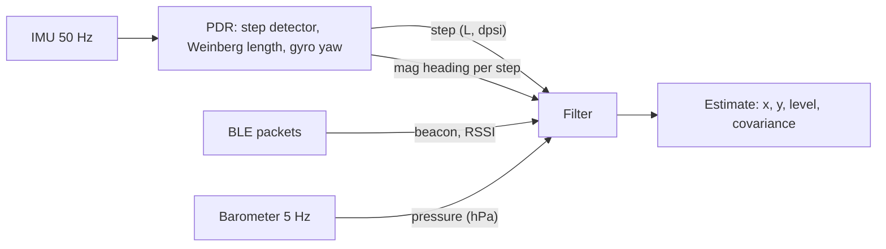

# Design notes

## Measurement pipeline

`PositioningEngine` is the only entry point a platform layer needs: push IMU samples, BLE packets and
barometer readings in time order, read the estimate. The filters share one interface (`Filter`), so the replay tool, the
regression suite and the WebAssembly demo can drive any of them with identical inputs.

## Pedestrian dead reckoning

- **Step detection**: low-pass filtered `|a| - g`, a peak above 1 m/s^2 confirmed by a fall below 0,
  with a 0.25 s refractory period.
- **Step length**: Weinberg, `L = K (a_max - a_min)^(1/4)` with `K = 0.48`. `K` is person specific, so the
  particle filter carries a per-user scale state rather than trusting it (see `office_step_scale`).
- **Heading**: gyro z integrated between steps gives `dpsi`; the magnetometer heading averaged over the
  step is a separate, outlier-prone absolute observation. Keeping them separate lets each filter decide
  how much to trust the magnetometer.

## Particle filter

State per particle: position, heading, step-length scale, device RSSI offset.

- **Motion**: `psi += dpsi + noise`, move `L * scale + noise` along `psi`. A particle whose move crosses a
  wall or leaves the venue gets weight zero. This is the main reason to use a particle filter here: the
  floor plan is a hard, non-Gaussian constraint that an EKF cannot express.
- **Venue area**: "the venue" is its bounds rectangle, intersected with the `footprint` polygon when the
  venue has one. Uniform draws (start, recovery, ring fallback) are rejection-sampled inside the footprint.
  The footprint matters for buildings that fill a small part of their bounds: in an L-shaped building,
  particles started in the empty corner sit outside the outline walls, and the walls keep them there.
- **RSSI likelihood**: log-distance path loss, minus `wall_attenuation_db` per wall on the straight radio
  path, plus the particle's device offset. The likelihood is a Gaussian/uniform mixture so one bad packet
  cannot wipe out the cloud.
- **Heading likelihood**: wrapped Gaussian with a 15% uniform component, since indoor magnetic anomalies
  are common rather than exceptional.
- **Resampling**: systematic, when ESS < N/2, followed by small position roughening that respects walls.
- **Recovery**: augmented MCL (`w_slow`/`w_fast`) injects up to 5% uniform particles when the short-term
  likelihood falls below the long-term one. If every particle dies, the cloud is re-seeded around the last
  estimate.
- **Beacon-driven proposal** (opt-in, `init_proposal` / `recovery_proposal`): after a 1 s collection
  window, the packet with the shortest apparent range re-seeds the cloud. 80% of the particles come from a
  ring around that beacon, with log-range normal around the inverted path-loss model for each particle's
  device offset; 20% stay uniform. Weights are prior/proposal, computed analytically. Draws that leave
  the venue are rejected jointly with their offset (up to 4 tries), so one acceptance rate normalises
  the truncated ring. Recovery can draw from the ring of a recent packet instead of uniformly. Off by
  default because it slows convergence in small walled venues (experiment 4).
- **Beacon integrity monitor**: once converged, keeps an exponential average of each beacon's RSSI
  residual at the estimate and stops using beacons whose bias exceeds 10 dB (re-admitted below 5 dB, never
  more than a third of the beacons).
- **Scans** (`on_rssi_scan`): a Wi-Fi scan reports dozens of access points at once. The filter applies
  the whole scan as one update: one device-offset random-walk step, one recovery-statistics update, one
  resample decision and one estimate. The integrity monitor still checks each reading. The scan's
  summed log-likelihood is multiplied by `k^-scan_tempering` for `k` readings: 0 (the default) treats
  readings as independent, and 1 counts the whole scan as one measurement, so an access point reported
  under several ids no longer counts several times. Tempering makes the cloud's spread honest but
  costs accuracy on the real traces, so it is off (see [real_data.md](real_data.md#scans-as-one-update)).
  A one-reading scan is bit-identical to `on_rssi`; the EKF and weighted centroid treat a scan as
  consecutive packets.
- **Wall queries** use a uniform grid over wall segments, with a linear scan for long radio paths where
  the grid would visit most cells anyway. A property test checks the grid against brute force.

## Floors

A venue is a stack of levels, each with its own walls, plus connectors (stairwells, lifts, escalators)
whose footprint polygons are the only places where anyone changes level.

### What tells the engine which floor it is on

- **Barometer.** Air pressure drops about 0.12 hPa per metre near sea level, so one 4 m storey is about
  0.48 hPa. A phone barometer has roughly 0.01-0.03 hPa of noise, so a floor change is 15-50 times the
  noise. The absolute reading is useless: weather moves it by several hPa a day, and phones disagree by a
  few hPa. Only changes over minutes are trusted. `BaroAltimeter` converts pressure to altitude with the
  barometric formula `h = 44330 (1 - (p / p0)^(1/5.255))`, low-passes it (`tau = 1 s`, which kills door
  slams and ventilation gusts) and reports it relative to the first sample.
- **RSSI.** A beacon on another floor is heard through the slab: the RSSI model uses the 3D distance
  `hypot(horizontal, dz)` and subtracts `floor_attenuation_db` per slab. Strong beacons right below or
  above the user can still look closer than same-floor beacons farther away (`office_floor_bleed`).
- **Steps.** Climbing stairs produces steps with little horizontal progress. The engine does not detect
  stairs from the IMU; it only lets particles change level where the map has stairs.

### Particle filter

Each particle carries a `level` and a `baro_offset`: the unknown altitude, in barometer metres, of the
floor of level 0 at the start of the walk. It absorbs weather, device bias and the unknown starting floor.

- **Motion.** After a step, a particle inside a connector that serves another level switches to an
  adjacent level with probability 0.08. Lifts produce no steps, so every barometer update (every 0.5 s)
  also offers the switch, with probability 0.1. Outside a connector the level never changes, so a particle
  cannot "teleport" through a slab. The offset follows a random walk (0.05 m per update) that tracks
  weather drift.
- **Barometer likelihood.** `z = (altitude - baro_offset - elevation(level)) / 0.8 m`, scored with a
  Gaussian plus a 5% uniform component over 20 m, so a pressure spike cannot wipe out the cloud. The first
  barometer sample sets each particle's offset from its own level (plus 0.3 m noise), so the barometer
  first learns which floor each hypothesis is on and only afterwards argues about changes.
- **RSSI likelihood** uses the particle's level for 3D distance, slab loss and the walls it counts.
- **Initialisation and recovery** sample levels as well as positions; recovery re-seeds around the last
  estimate on its level.
- **Estimate.** The level is the weighted mode over particles. Position and covariance are computed from
  the particles on that level only, so a minority hypothesis upstairs does not drag the mean into the
  wrong room.

Everything stays O(N) per measurement. On a single-floor venue none of this runs: no extra random draws,
no extra arithmetic, and the results are bit-identical to the single-floor engine.

### EKF and weighted centroid

They stay 2D, with simple floor rules so they remain baselines:

- **EKF:** at initialisation, the floor is a vote among the heard beacons weighted by inverse squared
  apparent distance, and the barometer is anchored to that floor's elevation. After that, the floor is
  barometric altitude plus the anchor, snapped to the nearest level. RSSI updates use 3D distance and slab
  loss. Nothing corrects the anchor after initialisation, which is exactly what `baro_drift_long` shows
  (67% floor accuracy under a 6 hPa/h weather trend, against 99.5% for the particle filter).
- **Weighted centroid:** floor = weighted vote among the strongest beacons; the centroid uses only beacons
  on that floor.

### Measuring it

`floor_accuracy` is the share of fixes on the correct floor. CEP50/CEP95 only count fixes on the correct
floor, because a horizontal error measured against a point on another floor is meaningless.
`floor_switch_latency_s` is the time from a true level change until the estimate reports the new floor.

## EKF

State `[x, y, psi]`. Steps drive the prediction with control noise mapped through the motion Jacobian;
magnetometer heading and each RSSI packet are scalar updates with chi-square gating, Joseph-form
covariance update and re-initialisation after 25 consecutive rejected packets. It is deliberately
map-free.

Packets weaker than -85 dBm are ignored. Without that, far beacons behind walls read ~10 dB below the
free-space prediction; because the linearised model is nearly flat at long range, each such packet pushes
the estimate a metre or two away from the beacon, and the filter drifted outside the building
(CEP50 21.6 m on `office_nominal`, 0.56 m with the threshold).

## Room enter and exit events

A venue can name rooms (polygons per floor, see [formats.md](formats.md#rooms)); `PositioningEngine`
then owns a `RoomTracker` and reports `Enter`/`Exit` events through `take_room_events()`.

- **Room probability.** With the particle filter it is the normalised particle weight inside the room on
  the room's floor, so a cloud split across a doorway gives both rooms a share. The EKF and weighted
  centroid have no cloud; their mean position gives 1 or 0. Without a valid fix every room is at 0.
  Candidate rooms come from a 5 m grid per floor, so a particle costs one cell lookup and a
  point-in-polygon test for the few rooms in that cell.
- **Debounce.** Each room has its own two-state machine, so overlapping rooms (a shop inside a hall) are
  independent. Outside, the probability must stay at or above `enter_prob` (0.6) for `enter_dwell_s`
  (1.5 s) before `Enter`; inside, at or below `exit_prob` (0.3) for `exit_dwell_s` (1.5 s) before `Exit`.
  The gap between the thresholds keeps a cloud hovering at 50% in a doorway from toggling, and the dwell
  removes short excursions. Exits at an update come before enters, so walking through a door reads
  "exit A, enter B". A lost fix exits every room after the exit dwell.
- **Cost.** Probabilities are recomputed at most every `update_period_s` (0.25 s), after any sensor
  update, so the cost does not scale with the IMU rate. The per-particle loop does not allocate; only
  emitting an event does.
- **Ground truth.** Replay runs the same tracker on the true position with a 0.5 threshold and no
  dwell, and scores the engine's events against it (metrics in
  [formats.md](formats.md#replay-outputs)). The dwell is a deliberate delay, so latency is at least
  1.5 s and `room_accuracy` loses a few samples at every transition even for a perfect estimate.

One seed each, default config:

| Scenario | Filter | True events | Precision | Recall | Median latency | Room accuracy |
|---|---|---|---|---|---|---|
| office_nominal | PF | 16 | 1.00 | 1.00 | 1.5 s | 0.89 |
| office_nominal | EKF | 16 | 0.72 | 0.81 | 1.6 s | 0.73 |
| office_nominal | WCL | 16 | 0.88 | 0.88 | 3.5 s | 0.79 |
| office_stairs_up_down | PF | 24 | 1.00 | 1.00 | 2.2 s | 0.83 |
| office_stairs_up_down | EKF | 24 | 0.96 | 0.96 | 1.7 s | 0.81 |
| office_stairs_up_down | WCL | 24 | 0.71 | 0.83 | 2.7 s | 0.74 |
| kit_tour (open-venue config) | PF | 34 | 0.96 | 0.79 | 1.9 s | 0.77 |

The particle filter's walls keep its cloud on the right side of a door, which is what room events need;
the EKF is more accurate than the centroid but cuts corners through walls, producing short visits to the
wrong office. In the KIT building most misses are short corridor segments and small rooms passed in
under the dwell time.

## Determinism

All sampling uses `ipe::Rng` (xoshiro256** + Box-Muller). `std::normal_distribution` is
implementation-defined, so the same seed would produce different traces under libstdc++, libc++ (used by
Emscripten) and MSVC. A golden-value test pins the generator.

## Known model limitations

- The simulator and the filters share the same family of propagation models (log-distance plus walls), so
  results are optimistic compared to real venues. The scenarios inject mismatches (wall loss, exponent,
  device offset, moved beacons) to reduce this, but the next step is replaying traces recorded on phones.
- The phone is assumed flat and pointing in the walking direction. Real PDR needs attitude estimation and
  handling of pocket/swing carry modes.
- Floors without a barometer: lift rides produce no steps, so only RSSI can reveal a lift ride on phones
  without a pressure sensor, and it does so slowly. Stair climbs are not detected from the IMU either.
- Floors are flat slabs. Mezzanines, atriums and split levels (a floor that is open to the one below, or
  ramps between half-levels) are not modelled; radio through an atrium is wrongly given slab loss.
- Connectors are polygons on the plan, so a long staircase that is itself inside a corridor polygon must be
  drawn tightly, or particles can change level on the corridor floor next to it.
- Shadowing is correlated in time per beacon, not in space.
- Room events are only as good as the position. In the MSIL malls (7-11 m typical error) the recorded
  walks stay in the corridors, so every event the engine reports there is a false enter into a shop
  next to the corridor; rooms smaller than the error, or visits shorter than the dwell time, are not
  detectable. The malls' room events are a demo of the plumbing, not a result.
