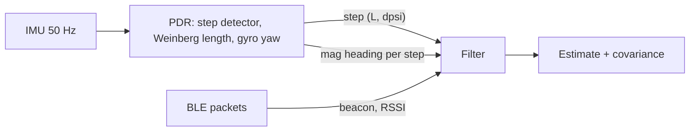

# Design notes

## Measurement pipeline

`PositioningEngine` is the only entry point a platform layer needs: push IMU samples and BLE packets in
time order, read the estimate. The filters share one interface (`Filter`), so the replay tool, the
regression suite and the WebAssembly demo can drive any of them with identical inputs.

## Pedestrian dead reckoning

- **Step detection**: low-pass filtered `|a| - g`, a peak above 1 m/s^2 confirmed by a fall below 0,
  with a 0.25 s refractory period.
- **Step length**: Weinberg, `L = K (a_max - a_min)^(1/4)` with `K = 0.48`. `K` is person specific, so the
  particle filter carries a per-user scale state rather than trusting it (see `office_step_scale`).
- **Heading**: gyro z integrated between steps gives `dpsi`; the magnetometer heading averaged over the
  step is a separate, outlier-prone absolute observation. Keeping them separate lets each filter decide
  how much to trust the magnetometer.

## Particle filter

State per particle: position, heading, step-length scale, device RSSI offset.

- **Motion**: `psi += dpsi + noise`, move `L * scale + noise` along `psi`. A particle whose move crosses a
  wall or leaves the venue gets weight zero. This is the main reason to use a particle filter here: the
  floor plan is a hard, non-Gaussian constraint that an EKF cannot express.
- **RSSI likelihood**: log-distance path loss, minus `wall_attenuation_db` per wall on the straight radio
  path, plus the particle's device offset. The likelihood is a Gaussian/uniform mixture so one bad packet
  cannot wipe out the cloud.
- **Heading likelihood**: wrapped Gaussian with a 15% uniform component, since indoor magnetic anomalies
  are common rather than exceptional.
- **Resampling**: systematic, when ESS < N/2, followed by small position roughening that respects walls.
- **Recovery**: augmented MCL (`w_slow`/`w_fast`) injects up to 5% uniform particles when the short-term
  likelihood falls below the long-term one. If every particle dies, the cloud is re-seeded around the last
  estimate.
- **Beacon integrity monitor**: once converged, keeps an exponential average of each beacon's RSSI
  residual at the estimate and stops using beacons whose bias exceeds 10 dB (re-admitted below 5 dB, never
  more than a third of the beacons).
- **Wall queries** use a uniform grid over wall segments, with a linear scan for long radio paths where
  the grid would visit most cells anyway. A property test checks the grid against brute force.

## EKF

State `[x, y, psi]`. Steps drive the prediction with control noise mapped through the motion Jacobian;
magnetometer heading and each RSSI packet are scalar updates with chi-square gating, Joseph-form
covariance update and re-initialisation after 25 consecutive rejected packets. It is deliberately
map-free.

Packets weaker than -85 dBm are ignored. Without that, far beacons behind walls read ~10 dB below the
free-space prediction; because the linearised model is nearly flat at long range, each such packet pushes
the estimate a metre or two away from the beacon, and the filter drifted outside the building
(CEP50 21.6 m on `office_nominal`, 0.56 m with the threshold).

## Determinism

All sampling uses `ipe::Rng` (xoshiro256** + Box-Muller). `std::normal_distribution` is
implementation-defined, so the same seed would produce different traces under libstdc++, libc++ (used by
Emscripten) and MSVC. A golden-value test pins the generator.

## Known model limitations

- The simulator and the filters share the same family of propagation models (log-distance plus walls), so
  results are optimistic compared to real venues. The scenarios inject mismatches (wall loss, exponent,
  device offset, moved beacons) to reduce this, but the next step is replaying traces recorded on phones.
- The phone is assumed flat and pointing in the walking direction. Real PDR needs attitude estimation and
  handling of pocket/swing carry modes.
- Single floor only; no barometer or floor transitions.
- Shadowing is correlated in time per beacon, not in space.
