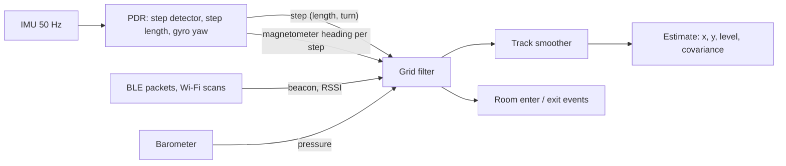
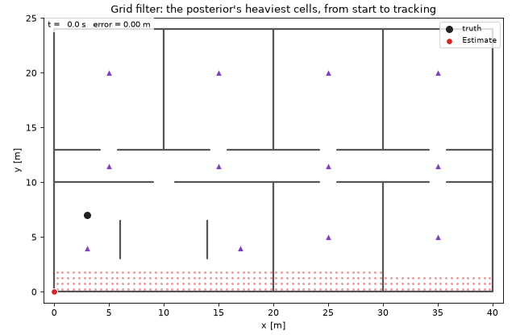

# Design

How the engine works today. Why it is this way, and what was tried on the way, is in
[history.md](history.md); how to add to it is in [extending.md](extending.md).

## Pipeline

`PositioningEngine` (`core/include/ipe/engine.hpp`) is the only entry point a platform layer needs: push
IMU samples, radio readings and barometer readings in time order, read the estimate. `TracePlayer` feeds a
recorded or simulated trace into it in timestamp order; the replay tool, the regression suite and the
WebAssembly demo all use it, so they see identical inputs.

### Where things live

| Concern | Code |
|---|---|
| Entry point, settings | `core/src/engine.cpp`, `core/src/config.cpp` |
| Steps from IMU samples | `core/src/pdr.cpp` |
| The venue as a lattice of cells: allowed moves, wall counts per beacon, rooms per cell | `core/src/grid_map.cpp` |
| Grid filter: state, start, applying a log-likelihood | `core/src/filter/grid_filter.cpp` |
| Steps and magnetometer heading | `core/src/filter/motion.cpp` |
| A radio update: integrity gate, log-distance model | `core/src/filter/radio.cpp`, `core/src/rssi_model.cpp`, `core/src/beacon_integrity.cpp` |
| Fingerprints and the floor vote | `core/src/filter/fingerprint.cpp`, `core/src/fingerprint_map.cpp`, `core/src/floor_classifier.cpp` |
| Barometer, floor changes | `core/src/filter/pressure.cpp`, `core/src/baro.cpp` |
| A position given from outside (a tap, a tag) | `core/src/filter/position_fix.cpp` |
| Recovery | `core/src/filter/recovery.cpp` |
| Reported estimate: level, position on the map | `core/src/filter/estimate.cpp`, `core/src/level_selector.cpp`, `core/src/map_estimate.cpp` |
| Drawn position between updates | `core/src/track_smoother.cpp` |
| Room events | `core/src/rooms.cpp` |
| Rooms nobody can walk into | `core/src/reachable_area.cpp` |
| Venue and trace files, trace playback | `core/src/venue.cpp`, `core/src/trace.cpp`, `core/src/trace_player.cpp` |
| Replay, metrics, regression comparison | `eval/src/eval.cpp`, `eval/src/regression.cpp` |

## Pedestrian dead reckoning

- **Step detection**: low-pass filtered `|a| - g`, a peak above 1 m/s^2 confirmed by a fall below 0, with
  a 0.25 s refractory period.
- **Step length**: Weinberg, `L = K (a_max - a_min)^(1/4)` with `K = 0.48`. `K` is person specific, so the
  filter does not trust it: its along-track noise grows with the step length.
- **Heading**: gyro z integrated between steps gives the turn; the magnetometer heading averaged over the
  step is a separate, outlier-prone absolute observation. Keeping them apart lets the filter decide how
  much to trust the magnetometer. A sample whose horizontal field is exactly zero has no magnetometer
  reading; steps then carry no absolute heading.

A motion model of your own can replace this stage: `PositioningEngine::on_step` takes its steps
([extending.md](extending.md#a-motion-model)).

## The grid filter

The engine holds the posterior as probability mass on a lattice of the venue's walkable cells (0.5 m by
default), with a distribution over heading in every cell. There are no particles and no random numbers:
the same inputs give the same estimate, on every platform. Its settings are `GridFilterConfig`
(`core/include/ipe/grid_filter.hpp`), the `filter` section of the config.

**Why a grid.** The floor plan is a hard, non-Gaussian constraint. A grid expresses it exactly: a cell that
cannot be stood on does not exist, and a move that crosses a wall is not in the cell's move mask. The
uniform prior is exact from the first update, so nothing has to seed, re-seed or inject hypotheses, and
room probability is simply the mass of a room's cells.

### The map (`GridMap`)

Built once per venue and shared read-only by every engine on it.

- **Cells.** One lattice over the venue bounds, 0.5 m cells (`cell_m`), coarser when the walkable area
  would need more than `max_cells` (200,000). A cell exists on a level when its centre is inside the venue's
  bounds, its `footprint` polygon if it has one, and the level's own footprint, and outside closed regions.
- **Closed regions** (`closed_region_fraction` 0.1, `closed_region_min_m2` 10). The walls split each level
  into connected regions. A region of at least 10 m^2, smaller than a tenth of its level's largest and
  without a stairwell or lift is closed: a room without a door, an island drawn as an outline. Its cells do
  not exist, so no Wi-Fi scan can pull the estimate in.
- **Moves.** Each cell has one bit per lattice offset within `max_reach_m` (2 m): set when the segment
  between the two centres crosses no wall and the target cell exists. A step's wall test is one bit.
- **Radio.** The walls between each cell's centre and each beacon are counted the first time the beacon is
  heard, by filling each wall's shadow as seen from the beacon lattice row by lattice row (1–10 ms per
  beacon). The result is exactly `Venue::count_wall_crossings`.
- **Floors and rooms.** Cells inside a connector (stairwell, lift, escalator) link to the cell at the same
  place on the levels next to it. Each cell lists the rooms its centre is in.

### The state

Per cell, so that a radio update costs O(cells):
- the cell's probability (mass);
- the centroid of that mass. Moves start from the centroid and land at exact points, so mass neither
  drifts towards cell centres nor smears between cells;
- the device RSSI offset and the barometer offset, each as a Gaussian.

Per (cell, heading bin), as `float`: the distribution of the heading within the cell, over 36 bins
(`heading_bins`). The bins are offsets from the gyro-integrated yaw, so a step's gyro turn shifts every
bin exactly; only the 3° per step process noise moves mass between bins.

### Updates

- **Step** (`motion.cpp`).
  1. The gyro turn and the heading noise.
  2. Every (cell, heading) moves along track to three lengths `L ± √3 σ`, weighted 1/6, 2/3, 1/6, with
     σ = √(0.08² + (0.2 L)²). They match the mean and variance of the step-length noise; the relative part
     also stands in for a per-user step-length scale.
  3. Mass whose move the mask does not allow dies at the wall.
  4. The rest lands in the target cells with its centroid and the moments of both offset Gaussians.
  5. In connector cells 8% of the mass moves to the levels next to it.
- **Magnetometer.** A wrapped Gaussian with a 15% uniform part, once per heading bin: indoor magnetic
  anomalies are common rather than exceptional.
- **Radio** (`radio.cpp`, `fingerprint.cpp`). A reading or a whole Wi-Fi scan is one update: a sum of
  log-likelihood terms per cell, applied together.
  - *Log-distance model.* The prediction is the path loss at the cell's centroid (3D distance and
    `floor_attenuation_db` per slab across levels), minus `wall_attenuation_db` per wall on the straight
    path, plus the cell's device offset. The likelihood is a Gaussian/uniform mixture, so one bad packet
    cannot wipe out the posterior, and the offset Gaussian is updated with the reading.
  - *Beacon integrity.* Once converged, the monitor averages each beacon's residual at the estimate and
    stops using beacons whose bias exceeds 10 dB (re-admitted below 5 dB, never more than a third of the
    beacons). It catches beacons that were moved or died.
  - *Fingerprints* (`fingerprint_weight`, off by default; 3 in `fingerprint.json`). On venues whose
    training scans carry positions, `FingerprintMap` returns a scan's 10 nearest training scans, compared
    over its 40 strongest readings (missing ones at -100 dBm), with weights 1 / (RMS difference + 1 dB).
    They form a kernel density over position and level: 4 m Gaussians around the neighbours plus 5% of the
    uniform prior. Every cell gets `fingerprint_weight` times its logarithm, and the log-distance term of
    that scan is scaled by `fingerprint_model_weight` (0.3), since both read the same scan. Beacons with
    `"model": false` are fingerprint dimensions only.
  - *Floor vote* (`floor_prior_weight`, off by default; 3 in `ipin.json` and `fingerprint.json`). A k-NN
    vote of the scan over the training scans gives p(level), applied as `weight · log p(level)` on every
    cell. The radio model's 2–4 dB per slab barely separates floors on real Wi-Fi.
- **Barometer** (`pressure.cpp`). Every 0.5 s: the altitude against the cell's level and offset, scored
  with a Gaussian plus a 5% uniform part over 20 m, then an update of the cell's offset. The first sample
  sets each cell's offset from its own level, so the barometer argues about changes, not absolute height.
  Lift rides produce no steps, so each barometer update also moves 10% of the mass in connector cells.
- **Position fix** (`position_fix.cpp`). A position known from outside the engine: a tap on the map, a QR
  code or NFC tag at a known place, a GNSS fix at an entrance. 1% of the uniform prior is mixed in first,
  so that it can move an estimate that is confidently somewhere else; then a Gaussian of the fix's sigma
  around it, on its level. Mass that is already near the fix outweighs the mixed-in prior and keeps its
  heading and offsets. Like a radio update it makes the estimate valid, so a venue without any radio can
  be walked from a fix on steps and walls alone.
- **Recovery** (`recovery.cpp`). A tiny share of uniform mass is mixed in (`teleport_rate_per_s`, 1e-8 per
  second): a way back from a wrong lock that a misbehaving beacon cannot exploit. If all mass dies, the
  filter starts again from the uniform prior.

### The estimate

- **Level.** The mass per level is averaged over 0.5 s (`level_smoothing_s`), and the reported level moves
  to another one only when that one leads by 0.1 (`level_hysteresis`), or at once when no mass is left on
  the reported level. A posterior split between floors then does not flicker with every packet.
- **Position.** Mean and covariance of the centroids on the reported level, plus the spread within a cell.
- **On the map** (`map_consistent_estimate`, on). The mean of a posterior split across a wall can fall on
  the wall or in an empty room. If the mean is outside the walkable area or a wall separates it from its
  nearest cell, the reported position is the mean of the dominant group instead: the heaviest 3x3 block of
  a 2 m weight histogram, keeping the block's cells on the same side of the walls.
- **Validity.** The estimate is invalid until radio has been applied.

### What is drawn

`PositioningEngine::estimate()` passes the filter's estimate through `TrackSmoother` (the `smoothing`
section); `raw_estimate()` is the filter's own. The smoother separates what the walker did from what the
filter learned:

- **Steps.** A step moves the dot at once by the step's own motion: the mean move of the mass that
  survived it. Whatever else the step did to the estimate counts as a correction.
- **Between steps.** The dot keeps moving at the last step's pace, centred on the filter's estimate. If no
  step comes for 1.2 s, the walker has stopped.
- **Corrections.** Every other change of the estimate is glided towards: after `dt`, the gap left is
  `exp(-dt / tau_s)` of what it was (`tau_s` 0.5 s). `max_correction_mps` caps the glide's speed; it is off
  by default and 1.5 m/s in the Wi-Fi configs, where one scan can move the estimate several metres.
- **Jumps.** The dot jumps when the estimate is more than 10 m away (`snap_m`) and when the level changes.
  An estimate behind a wall is glided towards only as far as the wall; the dot never slides through one.

Room events use the posterior, not the drawn point. `smoothing.enabled = false` gives the filter's estimate
bit for bit.

### Cost

Per step and per magnetometer update: O(cells × heading bins). Per radio reading: O(cells). Memory is about
8 bytes per (cell, heading bin) plus about 120 bytes per cell. A 960 m² office has 3,840 cells; the KIT
building 60,351 on 7 floors; a mall floor up to 200,000.

Replay on one desktop core (Ryzen 7 5800H): the simulated scenarios take 0.1–2 ms per sensor update
([results.md](results.md)); a mall walk takes a third to a half of its duration, more on the
largest floors with many access points. In WebAssembly the mall recordings take 0.5–1.2 of their duration,
so the demo's playback can wait for the engine. About half of that is the step loop; most of the rest is
`log10`, `exp` and `log` for every (cell, reading).

## Floors

A venue is a stack of levels, each with its own walls, plus connectors whose footprint polygons are the
only places where anyone changes level.

- **Barometer.** Air pressure drops about 0.12 hPa per metre, so a 4 m storey is 15–50 times a phone
  barometer's noise. The absolute reading is useless (weather moves it by several hPa a day, and phones
  disagree by a few hPa), so `BaroAltimeter` low-passes the altitude and reports it relative to the first
  sample.
- **RSSI.** A beacon on another floor is heard through the slab; strong beacons right below or above can
  still look closer than same-floor beacons farther away.
- **Steps.** The engine does not detect stairs from the IMU; it only lets mass change level where the map
  has stairs.

`floor_accuracy` is the share of fixes on the correct floor. CEP50/CEP95 only count fixes on the correct
floor. `floor_switch_latency_s` is the time from a true level change until the estimate reports the new
floor, and `level_flips` counts how often the reported floor changes
([formats.md](formats.md#replay-outputs)).

## Room enter and exit events

A venue can name rooms (polygons per floor, [formats.md](formats.md#rooms)); `PositioningEngine` then
reports `Enter`/`Exit` events through `take_room_events()`.

- **Room probability** is the mass in the room's cells, so a posterior split across a doorway gives both
  rooms a share. Without a valid fix every room is at 0.
- **Debounce.** Each room has its own two-state machine. Outside, the probability must stay at or above
  `enter_prob` (0.6) for `enter_dwell_s` (1.5 s) before `Enter`; inside, at or below `exit_prob` (0.3) for
  `exit_dwell_s` before `Exit`. The gap keeps a posterior hovering in a doorway from toggling.
- **Ground truth.** Replay runs the same tracker on the true position with a 0.5 threshold and no dwell,
  and scores the engine's events against it. The dwell is a deliberate delay, so latency is at least 1.5 s.

One seed each, default config:

| Scenario | True events | Precision | Recall | Median latency | Room accuracy |
|---|---|---|---|---|---|
| office_nominal | 16 | 1.00 | 1.00 | 1.7 s | 0.88 |
| office_stairs_up_down | 24 | 1.00 | 1.00 | 1.8 s | 0.85 |

## Determinism

The filter draws no random numbers. The simulator does, and all of its sampling uses `ipe::Rng`
(xoshiro256** + Box-Muller): `std::normal_distribution` is implementation-defined, so the same seed would
produce different traces under libstdc++, libc++ (used by Emscripten) and MSVC. A golden-value test pins
the generator.

## Known limitations

- **Simulation is optimistic.** The simulator and the filter share a family of propagation models. The
  scenarios inject mismatches (wall loss, exponent, device offset, moved beacons), but real errors are
  about ten times the simulated office's ([datasets.md](datasets.md)).
- **Phone handling.** The phone is assumed flat and pointing in the walking direction. Pocket and swing
  carry modes need attitude estimation.
- **The uncertainty is too small.** The model counts time-correlated packets and the readings of one scan
  as independent. The 95% ellipse holds the truth for 74% of the fixes on the simulated scenarios and for
  13–21% on real Wi-Fi.
- **Floor changes follow the position.** Mass changes floor only inside a connector. Dead reckoning can
  carry it out of a small stairwell before the barometer has seen half the climb; the floor then follows
  through recovery mass or the floor vote, seconds late. Without a barometer, only RSSI reveals a lift
  ride, slowly.
- **Floors are flat slabs.** Atriums and ramps between half-levels are not modelled.
- **Step length** has no per-user scale state; a wider along-track noise stands in for it.
- **Compute.** The filter touches every cell at every update. A sparse active set is the open route.
- **Room events are only as good as the position.** In the malls (5–7 m typical error) rooms smaller than
  the error are not detectable; the malls' room events are a demo of the plumbing, not a result.
- **Offline use.** Competitions scored offline reward whole-walk optimisation. The two-pass replay in
  `datasets/common/offline.py` is two causal filters combined; an exact forward-backward smoother on the
  grid is untried.
