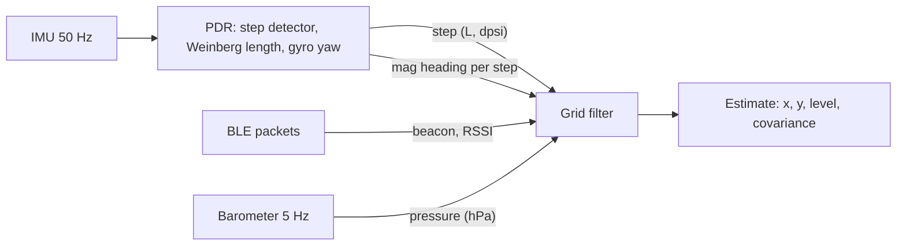

# Design notes

## Measurement pipeline

`PositioningEngine` is the only entry point a platform layer needs: push IMU samples, BLE packets and
barometer readings in time order, read the estimate. `TracePlayer` feeds a recorded or simulated
trace into it in timestamp order; the replay tool, the regression suite and the WebAssembly demo all
use it, so they see identical inputs.

### Where things live

| Concern | Code |
|---|---|
| Engine entry point, room events | `core/src/engine.cpp`, `core/src/rooms.cpp` |
| Trace streams in time order | `core/src/trace_player.cpp` |
| Grid filter: the posterior over the venue's cells, motion, measurement updates, recovery, estimate | `core/src/grid_filter.cpp` |
| The venue as a lattice of cells: allowed moves, wall counts per beacon, rooms per cell | `core/src/grid_map.cpp` |
| Beacon integrity monitor | `core/src/beacon_integrity.cpp` |
| Nearest training scans of a scan (fingerprint likelihood) | `core/src/fingerprint_map.cpp` |
| Estimate kept on the map (dominant group of a split posterior) | `core/src/map_estimate.cpp` |
| Closed regions that are not cells (rooms without a door) | `core/src/reachable_area.cpp` |
| Reported level (averaged level weights with hysteresis) | `core/src/level_selector.cpp` |
| Drawn position: filter estimate smoothed between updates | `core/src/track_smoother.cpp` |
| Config JSON, presets, replay, metrics | `eval/src/eval.cpp` |

**Adding a sensor.** Add a stream to `Trace` (and its CSV reader/writer in `core/src/trace.cpp`), a
case to `TracePlayer::step`, an `on_x` to `PositioningEngine`, and an `on_x` to `GridFilter` that
fills `loglik_` with one log-likelihood per cell and calls `apply_cell_loglik(t)`. The
simulator (`sim/`) generates the stream for scenarios; new config fields go into the JSON registration
in `eval/src/eval.cpp`.

## Pedestrian dead reckoning

- **Step detection**: low-pass filtered `|a| - g`, a peak above 1 m/s^2 confirmed by a fall below 0,
  with a 0.25 s refractory period.
- **Step length**: Weinberg, `L = K (a_max - a_min)^(1/4)` with `K = 0.48`. `K` is person specific, so the
  filter does not trust it: its along-track noise grows with the step length (see `office_step_scale`).
- **Heading**: gyro z integrated between steps gives `dpsi`; the magnetometer heading averaged over the
  step is a separate, outlier-prone absolute observation. Keeping them separate lets the filter decide
  how much to trust the magnetometer.

## Grid filter

The engine holds the posterior as probability mass on a lattice of the venue's walkable cells (0.5 m by
default), with a distribution over heading in every cell. There are no particles and no random numbers:
the same inputs give the same estimate, on every platform. [grid.md](grid.md) describes the lattice, the
state and every update in detail; in short:

- **Why a grid.** The floor plan is a hard, non-Gaussian constraint that a Gaussian filter cannot express.
  A grid expresses it exactly: a cell that cannot be stood on does not exist, and a move that crosses a
  wall is not in the cell's move mask. The uniform prior is exact from the first update, so nothing has to
  seed, re-seed or inject hypotheses (experiments 14 and 16 in [experiments.md](experiments.md)).
- **Venue area.** A cell exists on a level when its centre is inside the venue's bounds, its `footprint`
  polygon if it has one, and the level's own footprint, and outside closed regions.
- **Closed regions** (`filter.closed_region_fraction` 0.1, `filter.closed_region_min_m2` 10): the walls
  split each level into connected regions, and a walker never gets from one to another except by a
  stairwell or lift. A region of at least 10 m^2, smaller than a tenth of its level's largest and without
  a connector is closed: a room without a door, an island drawn as an outline (`ReachableArea`, a 0.25 m
  grid built once). Its cells do not exist, so no Wi-Fi scan can pull the estimate in (experiment 13).
- **Motion.** A step turns every heading bin by the gyro and moves each cell's mass along its headings to
  three lengths that match the step-length noise. Mass whose move crosses a wall or leaves the venue dies.
- **RSSI likelihood**: log-distance path loss, minus `wall_attenuation_db` per wall on the straight radio
  path, plus the cell's device offset (a Gaussian per cell). The likelihood is a Gaussian/uniform mixture
  so one bad packet cannot wipe out the posterior.
- **Heading likelihood**: wrapped Gaussian with a 15% uniform component, since indoor magnetic anomalies
  are common rather than exceptional.
- **Recovery.** A tiny share of uniform mass is mixed in (`filter.teleport_rate_per_s`, 1e-8 per second):
  a way back from a wrong lock that a misbehaving beacon cannot exploit. If all mass dies, the filter
  starts again from the uniform prior.
- **Beacon integrity monitor**: once converged, keeps an exponential average of each beacon's RSSI
  residual at the estimate and stops using beacons whose bias exceeds 10 dB (re-admitted below 5 dB, never
  more than a third of the beacons).
- **Scans** (`on_rssi_scan`): a Wi-Fi scan reports dozens of access points at once. The filter applies
  the whole scan as one update and one estimate. The integrity monitor still checks each reading. Tempering
  a scan's likelihood made the spread honest but cost accuracy at every setting tried, and was removed
  (see [real_data.md](real_data.md#scans-as-one-update)).
- **Fingerprints** (`filter.fingerprint_weight`, off by default; `data/configs/fingerprint.json`). A venue
  can carry training scans with the position they were taken at. For each scan `FingerprintMap` returns the
  10 nearest training scans, compared over the scan's 40 strongest readings (missing ones at -100 dBm),
  with weights 1 / (RMS difference + 1 dB). They form a kernel density over position and level: 4 m
  Gaussians around the neighbours plus 5% of the uniform prior. The filter adds `fingerprint_weight` times
  its logarithm to every cell's log-likelihood and scales the log-distance term by
  `fingerprint_model_weight` (0.3), since both read the same scan. Beacons with `"model": false` are
  fingerprint dimensions only. A scan without neighbours, single packets and venues without positions
  behave exactly as without the setting ([benchmarks.md](benchmarks.md#what-changed-in-the-engine)).
- **Wall queries** for the lattice and the radio model use a uniform grid over wall segments, with a
  linear scan for long radio paths where the grid would visit most cells anyway. A property test checks
  the grid against brute force.
- **Cost.** A radio reading costs O(cells) and a step O(cells x heading bins): a few percent of real time
  on one core for an office, up to about half of real time for a mall floor of 200,000 cells
  ([grid.md](grid.md#cost)).

### What is drawn

`PositioningEngine::estimate()` passes the filter's estimate through `TrackSmoother`
(`EngineConfig::smoothing`); `raw_estimate()` is the filter's own. The filter recomputes its estimate after
every packet, step and heading update, so drawn as-is it shakes (jitter p95 about 1 m on `office_nominal`)
and on real Wi-Fi jumps several times a minute. The smoother separates what the walker did from what the
filter learned (experiments 8 and 11):

- **Steps.** A step moves the dot at once by the step's own motion, `GridFilter::step_motion()`: the mean
  move of the mass that survived it. Whatever else the step did to the estimate (mass dying at walls)
  counts as a correction, and so does the magnetometer update after it.
- **Between steps.** The dot keeps moving at the last step's pace (`smoothing.extrapolate_steps`, one step
  interval). The motion is centred on the filter's estimate: half a step behind it at a step, half a step
  ahead at the next. Radio holds the estimate on the walker's mean position over a step interval, so
  running ahead of it would draw the dot half a step too far. If no step comes for
  `smoothing.max_step_interval_s` (1.2 s), the walker has stopped and the offset is taken back.
- **Corrections.** Every other change of the estimate is glided towards in continuous time: after `dt`, the
  gap left is `exp(-dt / tau_s)` of what it was (`smoothing.tau_s` = 0.5 s). A correction is never drawn at
  the instant it arrives, whether updates come every 40 ms (BLE) or every 2 s (a Wi-Fi scan).
  `smoothing.max_correction_mps` caps the glide's speed; it is off by default and 1.5 m/s in the Wi-Fi
  configs, where one scan can move the estimate several metres.
- **Jumps.** The dot jumps to the filter's estimate when that is more than 10 m away (`smoothing.snap_m`)
  and when the reported level changes. An estimate behind a wall is glided towards only as far as the wall.
  If it is still behind the wall once the dot gets there, the dot jumps; often it has come back first (a
  posterior split by a wall). The dot never slides through a wall.
- **Covariance.** The filter's covariance is reported about the drawn point, so `coverage95` stays honest.

Room events use the posterior, not the drawn point, so they are unaffected. `smoothing.enabled = false`
gives the filter's estimate bit for bit.

## Floors

A venue is a stack of levels, each with its own walls, plus connectors (stairwells, lifts, escalators)
whose footprint polygons are the only places where anyone changes level.

### What tells the engine which floor it is on

- **Barometer.** Air pressure drops about 0.12 hPa per metre near sea level, so one 4 m storey is about
  0.48 hPa. A phone barometer has roughly 0.01-0.03 hPa of noise, so a floor change is 15-50 times the
  noise. The absolute reading is useless: weather moves it by several hPa a day, and phones disagree by a
  few hPa. Only changes over minutes are trusted. `BaroAltimeter` converts pressure to altitude with the
  barometric formula `h = 44330 (1 - (p / p0)^(1/5.255))`, low-passes it (`tau = 1 s`, which kills door
  slams and ventilation gusts) and reports it relative to the first sample.
- **RSSI.** A beacon on another floor is heard through the slab: the RSSI model uses the 3D distance
  `hypot(horizontal, dz)` and subtracts `floor_attenuation_db` per slab. Strong beacons right below or
  above the user can still look closer than same-floor beacons farther away (`office_floor_bleed`).
- **Steps.** Climbing stairs produces steps with little horizontal progress. The engine does not detect
  stairs from the IMU; it only lets mass change level where the map has stairs.

### In the filter

Every cell belongs to one level and carries a barometer offset as a Gaussian: the unknown altitude, in
barometer metres, of the floor of level 0 at the start of the walk. It absorbs weather, device bias and the
unknown starting floor.

- **Motion.** After a step, 8% of the mass in a connector cell moves to the cell at the same place on the
  levels next to it. Lifts produce no steps, so every barometer update (every 0.5 s) also moves 10%.
  Outside a connector the level never changes, so mass cannot "teleport" through a slab. The offset follows
  a random walk (0.05 m per update) that tracks weather drift.
- **Barometer likelihood.** `z = (altitude - offset - elevation(level)) / 0.8 m`, scored with a Gaussian
  plus a 5% uniform component over 20 m, so a pressure spike cannot wipe out the posterior, and followed by
  an assumed-density update of the cell's offset. The first barometer sample sets each cell's offset from
  its own level, so the barometer first learns which floor each hypothesis is on and only afterwards argues
  about changes.
- **RSSI likelihood** uses the cell's level for 3D distance, slab loss and the walls it counts.
- **Floor prior** (`filter.floor_prior_weight`, off by default). On a venue with floor fingerprints, a
  k-NN vote of each scan over the training scans gives p(level), applied as `weight * log p(level)` on every
  cell (`core/src/floor_classifier.cpp`).
- **Estimate.** The mass per level is averaged over 0.5 s (`filter.level_smoothing_s`), and the reported
  level moves to another one only when that one leads by 0.1 in the average (`filter.level_hysteresis`), or
  at once when no mass is left on the reported level. A posterior split between floors then does not
  flicker with every packet, and a real floor change shows about 0.4 s later (experiment 7). Position and
  covariance are computed from the cells on the reported level only, so a minority hypothesis upstairs
  does not drag the mean into the wrong room. The filter's own decisions (the integrity monitor) use the
  most likely level of the current update, so the hysteresis changes what is reported, not how the filter
  evolves.
- **Estimate on the map** (`filter.map_consistent_estimate`, on by default). Mass never crosses walls, but
  the mean of a posterior split across a wall (corridor and shop, two corridors) can fall on the wall, in
  an empty shop or behind a wall from all of the mass. If the mean is outside the walkable area or a wall
  separates it from its nearest cell, the reported position is the mean of the dominant group instead: the
  heaviest 3x3 block of a 2 m weight histogram, keeping only the block's cells on the same side of the
  walls as the one nearest the block's centre. The covariance is taken about the reported point, so it
  still covers the whole posterior (experiment 6).

### Measuring it

`floor_accuracy` is the share of fixes on the correct floor. CEP50/CEP95 only count fixes on the correct
floor, because a horizontal error measured against a point on another floor is meaningless.
`floor_switch_latency_s` is the time from a true level change until the estimate reports the new floor.
`level_flips` counts how often the reported floor changes, so a flickering floor shows up even when
`floor_accuracy` is high ([formats.md](formats.md#replay-outputs)).

## Room enter and exit events

A venue can name rooms (polygons per floor, see [formats.md](formats.md#rooms)); `PositioningEngine`
then owns a `RoomTracker` and reports `Enter`/`Exit` events through `take_room_events()`.

- **Room probability.** It is the mass in the room's cells, so a posterior split across a doorway gives
  both rooms a share. Without a valid fix every room is at 0. Each cell's rooms are listed once, when the
  lattice is built.
- **Debounce.** Each room has its own two-state machine, so overlapping rooms (a shop inside a hall) are
  independent. Outside, the probability must stay at or above `enter_prob` (0.6) for `enter_dwell_s`
  (1.5 s) before `Enter`; inside, at or below `exit_prob` (0.3) for `exit_dwell_s` (1.5 s) before `Exit`.
  The gap between the thresholds keeps a posterior hovering at 50% in a doorway from toggling, and the dwell
  removes short excursions. Exits at an update come before enters, so walking through a door reads
  "exit A, enter B". A lost fix exits every room after the exit dwell.
- **Cost.** Probabilities are recomputed at most every `update_period_s` (0.25 s), after any sensor
  update, so the cost does not scale with the IMU rate. The loop over cells does not allocate; only
  emitting an event does.
- **Ground truth.** Replay runs the same tracker on the true position with a 0.5 threshold and no
  dwell, and scores the engine's events against it (metrics in
  [formats.md](formats.md#replay-outputs)). The dwell is a deliberate delay, so latency is at least
  1.5 s and `room_accuracy` loses a few samples at every transition even for a perfect estimate.

One seed each, default config:

| Scenario | True events | Precision | Recall | Median latency | Room accuracy |
|---|---|---|---|---|---|
| office_nominal | 16 | 1.00 | 1.00 | 1.5 s | 0.89 |
| office_stairs_up_down | 24 | 1.00 | 1.00 | 2.2 s | 0.83 |
| kit_tour (open-venue config) | 34 | 0.96 | 0.79 | 1.9 s | 0.77 |

The walls keep the mass on the right side of a door, which is what room events need. In the KIT building
most misses are short corridor segments and small rooms passed in under the dwell time.

## Determinism

The filter draws no random numbers. The simulator does, and all of its sampling uses `ipe::Rng`
(xoshiro256** + Box-Muller): `std::normal_distribution` is implementation-defined, so the same seed would
produce different traces under libstdc++, libc++ (used by Emscripten) and MSVC. A golden-value test pins
the generator.

## Known model limitations

- The simulator and the filter share the same family of propagation models (log-distance plus walls), so
  results are optimistic compared to real venues. The scenarios inject mismatches (wall loss, exponent,
  device offset, moved beacons) to reduce this, but the next step is replaying traces recorded on phones.
- The phone is assumed flat and pointing in the walking direction. Real PDR needs attitude estimation and
  handling of pocket/swing carry modes.
- Floors without a barometer: lift rides produce no steps, so only RSSI can reveal a lift ride on phones
  without a pressure sensor, and it does so slowly. Stair climbs are not detected from the IMU either.
- Floors are flat slabs. A level can be smaller than the building (its own `footprint`, e.g. a stair
  landing), but atriums and ramps between half-levels are not modelled; radio through an atrium is wrongly
  given slab loss, and sloped outdoor ground reads as a floor change on the barometer
  ([ipin.md](ipin.md#failure-modes)).
- One loss per slab for the whole venue and one floor per transmitter separate floors poorly on real
  Wi-Fi: on the IPIN buildings a nearest-neighbour fingerprint finds the floor for 93-95% of scans, while
  the fitted slab loss is 2-4 dB ([ipin.md](ipin.md#failure-modes)). A venue can carry those fingerprints
  (`floor_fingerprints`). `filter.floor_prior_weight` then applies a k-NN floor vote per scan
  (`core/src/floor_classifier.cpp`); it is off by default.
  With positions on those fingerprints, `filter.fingerprint_weight` applies them to position as well, which
  is what brought the IPIN buildings to the competition winners' range ([benchmarks.md](benchmarks.md)).
- Mass changes floor only inside a connector, so the floor can only follow once the position is right.
  Dead reckoning can carry the mass out of a small stairwell before the barometer has seen half the climb;
  the floor then follows through recovery mass or the floor prior, seconds late
  ([grid.md](grid.md#updates)). The particle filter this engine had until experiment 16 could move
  hypotheses to the nearest stairs on a sustained barometer change; the grid filter has no such step yet.
- Connectors are polygons on the plan, so a long staircase that is itself inside a corridor polygon must be
  drawn tightly, or mass can change level on the corridor floor next to it.
- The step length has no per-user scale state: a wider along-track noise stands in for it, which costs a
  walker whose stride is far from the model's (`office_step_scale`).
- The reported uncertainty is too small: the model counts time-correlated packets and the readings of one
  scan as independent, and nothing in a grid adds spread the way sampling noise did.
- Compute. The filter touches every cell at every update: fine for an office on a phone, about half of
  real time on a desktop core for a mall floor of 200,000 cells ([grid.md](grid.md#cost)). A sparse active
  set is the open route.
- Shadowing is correlated in time per beacon, not in space.
- Room events are only as good as the position. In the MSIL malls (7-11 m typical error) the recorded
  walks stay in the corridors, so every event the engine reports there is a false enter into a shop
  next to the corridor; rooms smaller than the error, or visits shorter than the dwell time, are not
  detectable. The malls' room events are a demo of the plumbing, not a result.
