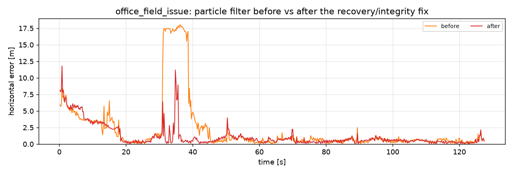

# Experiment log

Each entry: the observation, the hypothesis, the change, and the measured effect across all scenarios.
Numbers are means over seeds (`ipe-regress --no-baseline --seeds N`).

## 2. Moved beacon hijacking the particle filter (`office_field_issue`)

**Observation.** The particle filter's CEP95 on this scenario was 5.41 m (5 seeds), with a 17 m error
plateau between t = 30 s and 40 s.

**Diagnosis.** S3 is mapped in the south meeting room but physically sits in room N3. When the walker
enters N3, S3 reads ~25 dB stronger than the map predicts. The short-term likelihood drops, augmented-MCL
recovery injects uniform particles, and the ones that land next to S3's *mapped* position explain its
packets perfectly. The doors line up (x = 25 m on both corridor walls), so the other beacons barely
contradict the alias. Once the cloud has jumped, walls keep it there until those particles die out.

**Things tried** (5-8 seeds, all seven scenarios):

| Variant | field_issue CEP95 | device_offset CEP95 | airport CEP95 | Verdict |
|---|---:|---:|---:|---|
| original (`alpha_fast` 0.3, offset prior 5 dB) | 5.41 | 2.41 | 6.58 | hijack |
| recovery off | 2.30 | 8.18 | 6.34 | device offset never learned |
| recovery off + wider priors | 2.11 | 1.66 | 13.14 | airport loses track in 1/5 runs |
| `alpha_fast` 0.1 + wider priors | 2.62 | 2.99 | 8.35 | |
| **`alpha_fast` 0.05 + wider priors** | **2.19** | **2.04** | **7.43** | kept |

"Wider priors" means device-offset prior 5 -> 8 dB and step-scale prior 0.10 -> 0.15. Most recovery
injections were really compensating for priors too narrow to contain the true offset or step scale. With
wider priors, recovery only has to handle real loss of track, so it can react more slowly and is no
longer triggered by a few seconds of one inconsistent beacon.

**Beacon integrity monitor.** Added at the same time: per-beacon residual averaging at the converged
estimate, with exclusion above 10 dB. Its effect on top of the recovery change is small but consistent
(field_issue CEP95 2.32 -> 2.19 m, others unchanged within noise).

**20-seed check of the kept change.** The 5-8 seed numbers above were too noisy to judge side effects,
so the original and kept configurations were rerun with 20 seeds (CEP95, m):

| Scenario | original | kept | |
|---|---:|---:|---|
| office_field_issue | 3.69 | 2.01 | better |
| office_device_offset | 3.77 | 2.87 | better |
| office_nominal | 1.51 | 1.54 | same |
| office_nlos_heavy | 1.80 | 1.75 | same |
| office_mag_disturbance | 2.48 | 2.52 | same |
| office_step_scale | 1.51 | 1.76 | worse |
| airport_hall_sparse | 5.60 | 7.27 | worse |

Reverting one piece at a time (20 seeds) shows both halves of the change cost the airport hall:
offset prior back to 5 dB gives airport 6.32 m but device offset 4.68 m; `alpha_fast` back to 0.3 gives
airport 6.33 m but field issue 2.53 m. The integrity monitor makes no difference to the airport hall
(7.27 m either way). No single setting won everywhere, so the kept configuration favours the
deployment faults, which are the common field complaint, and the airport cost is tracked below.

## 3. Cross-platform determinism

The WebAssembly demo (Clang + libc++) and the native CLI (GCC + libstdc++) report identical metrics for
the same seed, e.g. `office_field_issue` seed 1: mean 0.71 m / CEP95 1.70 m. This holds because all randomness uses `ipe::Rng` instead of `std::normal_distribution`.

## 4. Beacon-driven proposal (airport hall convergence)

**Observation.** Airport hall convergence took ~70 s, and the slower recovery trigger from experiment 2
had cost it CEP95 (5.6 -> 7.3 m). The particle filter starts uniform over 3200 m^2 and injects recovery
particles uniformly too, so a sparse hall with 35% packet loss needs a long time to find the right mode.

**Change.** Two opt-in proposals (`pf.init_proposal`, `pf.recovery_proposal`):

- *Init.* Packets are collected for `init_window_s` (1 s). The one with the shortest apparent range then
  re-seeds the cloud: 80% of the particles come from a range ring around that beacon, 20% stay uniform.
  The ring inverts the path-loss model for each particle's own device offset, so offset and range are
  consistent. Every particle is importance-weighted by prior/proposal, and then every collected packet
  is applied as usual. The result is the same posterior as a uniform start, sampled more densely where
  the radio says the user is. A unit test checks that the weighted cloud reproduces the uniform prior
  over position, device offset and level; another checks the ring density against a brute-force grid.
- *Recovery.* Augmented-MCL injections are drawn from the ring of a random packet heard in the last 2 s
  instead of uniformly.

Two earlier versions were discarded. The first drew the range and the device offset independently, and
most particles had a range that did not fit their own offset. The second seeded from the first packet
received, often a far beacon behind walls. Both were worse in every office scenario.

**Result** (CEP95 [m] / convergence, mean over 20 seeds, `pf` preset):

| Scenario | uniform | init | recovery | both |
|---|---:|---:|---:|---:|
| airport_hall_sparse | 7.26 / 71 s | **5.40 / 41 s** | 7.66 / 73 s | 5.70 / 42 s |
| baro_drift_long | 2.02 / 12 s | 1.87 / 6 s | 1.84 / 9 s | 1.81 / 4 s |
| office_stairs_up_down | 2.89 / 10 s | 2.04 / 4 s | 2.44 / 8 s | 1.86 / 4 s |
| office_step_scale | 1.76 / 2 s | 1.58 / 5 s | 1.71 / 2 s | 1.68 / 6 s |
| office_floor_bleed | 4.22 / 7 s | 4.97 / 21 s | 3.72 / 10 s | 3.81 / 16 s |
| office_device_offset | 2.87 / 6 s | 3.82 / 19 s | 2.12 / 5 s | 2.99 / 13 s |
| office_field_issue | 2.01 / 4 s | 2.60 / 7 s | 2.83 / 4 s | 2.36 / 8 s |
| office_elevator | 1.95 / 2 s | 2.67 / 10 s | 2.00 / 3 s | 2.53 / 7 s |
| office_mag_disturbance | 2.52 / 3 s | 2.66 / 5 s | 2.44 / 3 s | 2.64 / 4 s |
| office_nlos_heavy | 1.75 / 2 s | 2.65 / 9 s | 1.74 / 2 s | 2.71 / 9 s |
| office_nominal | 1.54 / 2 s | 1.78 / 5 s | 1.52 / 2 s | 1.86 / 4 s |

The init proposal answers the airport question. Convergence drops from 71 s to 41 s, and CEP95 drops to
5.4 m, below the 5.6 m the hall had before experiment 2. The two-floor walks gain too. It costs every
small walled office: convergence goes from 2-6 s to 5-21 s and CEP95 rises by 0.2-1 m.

The recovery proposal alone is close to neutral on the walls-and-offset scenarios and helps
`office_device_offset` and `office_floor_bleed`. It also brings back the moved-beacon hijack of
experiment 2 (`office_field_issue` 2.01 -> 2.83 m): when the packet that
triggers recovery comes from the moved beacon, the new particles land at its mapped position.

Ruled out as the cause of the office cost:

- The importance weights, which pass the prior-recovery test.
- The integrity monitor: disabling it does not change the failing seeds.
- The ring width: 2x and 3x the RSSI sigma were no better at 10 seeds.

The likely reason, not verified: 1500 particles over a 40 x 24 m office are already 1.6 per m^2, so a
uniform start samples the prior well. Putting 80% of them on one free-space ring, which ignores walls,
trades away diversity in heading, step scale and offset for density the office does not need.

**Kept.** Both proposals stay off by default, so `tests/regression/baseline.json` is unchanged and
the default filter is bit-identical (unit test `ProposalSettingsAreInertWhenDisabled`, and identical
10-seed regression output). [`data/configs/open_venue.json`](../data/configs/open_venue.json) turns on
the init proposal for large open venues:
`ipe-replay --config data/configs/open_venue.json ...`.

## 6. Estimates that go through walls

**Symptom.** In the web demo the dot slides into and through walls, mostly on the mall walks.

**Cause.** No particle crosses a wall: 1.3 M particle steps on two mall walks were checked with
`crosses_wall(before, after)`, and none did. The reported position is the weighted mean of the cloud,
though. When the cloud is split across a wall (corridor and shop, two corridors), the mean lands between
the groups: on the wall, in an empty shop, or behind a wall from every particle. On the ten `data/real`
demo walks (shop walls), 1,705 of 64,776 estimates were outside the walkable area or separated by a wall
from their nearest particle.

**Change.** The filter reports the mean of its dominant group when the cloud mean is not on the map
(`pf.map_consistent_estimate`, on by default). It only changes what is reported; the integrity monitor
and recovery keep using the cloud mean, so the filter evolves as before. The web demo leaves a gap in the
trail where two consecutive estimates are separated by a wall.

**Results.** CEP50 / CEP95 [m]. Simulated: 10 seeds per scenario. Real: `ipe-regress --traces`
with `msil_wifi.json`, median over walks. "Before" is the code before the change, and is bit-identical
to `map_consistent_estimate=false`.

| Data | Before | After |
|---|---:|---:|
| office_nominal | 0.66 / 1.59 | 0.66 / 1.59 |
| office_field_issue | 0.72 / 2.00 | 0.72 / 1.98 |
| office_mag_disturbance | 1.09 / 2.63 | 1.09 / 2.60 |
| airport_hall_sparse | 1.30 / 7.25 | 1.30 / 7.25 |
| kit_tour | 2.27 / 11.10 | 2.28 / 11.02 |
| MSIL holdout, floor outline (109 walks) | 11.79 / 15.25 | 11.79 / 15.43 |
| MSIL holdout, shop walls (demo maps) | 12.23 / 17.28 | 12.20 / 17.45 |
| MSIL tune, shop walls | 11.45 / 15.83 | 11.36 / 16.38 |

The other seven simulated scenarios are unchanged to within 0.01 m. On the ten demo walks, estimate moves
that cross a wall go from 4.8% to 3.6%, and estimates off the map from 1,705 to 0. The remaining moves
through a wall are jumps from one group of particles to another, which the demo draws as gaps.

**Findings.**

- The change is neutral on accuracy. Simulated scenarios move by 0.01 m or less. On real data CEP50 is
  unchanged and CEP95 rises by 1-3%. One `real_data_regression` group moves past the 10% tolerance:
  site2 F5, CEP95 75.6 to 84.3 m. Its 2 walks are lost in every configuration (CEP50 54 m), and when the
  cloud is lost its mean happens to be closer to the truth than either group.
  `tests/regression/msil_baseline.json` was regenerated to accept it.
- `compute_us_per_update` (`--serial`, 2 seeds) moves by 1% or less.

**Kept.** `map_consistent_estimate` on.

## Open questions

- The beacon-driven init proposal (experiment 4) fixes the airport hall but slows small walled offices.
  Choosing it automatically, for example from particle density per level or from the ring's share of
  the venue, needs more than two venue types to tune on without overfitting. A wall-aware ring
  (rejection sampling against the full likelihood) is the other candidate.
- `office_nlos_heavy`: the wall-aware model assumes 3.5 dB per wall while the truth is 7 dB; estimating
  wall loss online (per venue) is a natural next state to add.
